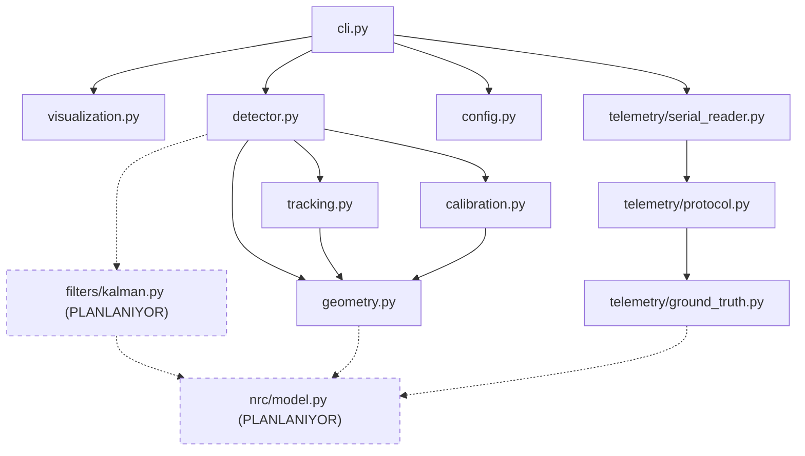

# Hedef Monorepo Dizin Yapısı

Bu rapor, mevcut dağınık kök dizini kurumsal açık kaynak depo düzenine taşıyan
hedef ağacı ve dosya dosya taşıma eşlemesini tanımlar.

Referans olgunluk modeli: `qwen-code` deposu — kaynak kodu `src/` altında
paketlenmiş, testler ayrı `tests/` ağacında, CI `.github/workflows/` içinde,
dokümanlar `docs/` altında, yardımcı betikler `scripts/` içinde.

---

## 1. Hedef ağaç

```text
vehicle-speed-estimation/
│
├── .github/
│   ├── ISSUE_TEMPLATE/
│   │   ├── bug_report.yml              # GitHub Issue Forms (YAML)
│   │   ├── feature_request.yml
│   │   ├── research_proposal.yml       # akademik deney önerisi
│   │   └── config.yml                  # boş issue'ları kapat, yönlendirme
│   ├── workflows/
│   │   ├── ci.yml                      # lint + type + test matrisi
│   │   ├── firmware.yml                # PlatformIO derleme + cppcheck
│   │   ├── release.yml                 # tag → build → GitHub Release
│   │   ├── codeql.yml                  # güvenlik taraması
│   │   └── labeler.yml                 # dosya yoluna göre otomatik etiket
│   ├── PULL_REQUEST_TEMPLATE.md
│   ├── CODEOWNERS
│   ├── labeler.yml
│   └── dependabot.yml
│
├── src/
│   └── vehicle_speed/
│       ├── __init__.py                 # __version__ burada
│       ├── py.typed                    # PEP 561 tip işareti
│       ├── config.py                   # dataclass/pydantic yapılandırma
│       ├── geometry.py                 # pinhole: estimate_depth, project_3d
│       ├── tracking.py                 # history, speed_cache, compute_speed
│       ├── calibration.py              # HFOV/focal türetme, ölçek referansları
│       ├── detector.py                 # YOLO sarmalayıcı (BALL/PLATE/POSE modları)
│       ├── telemetry/
│       │   ├── __init__.py
│       │   ├── serial_reader.py        # pyserial tabanlı, parametrik port
│       │   ├── protocol.py             # ESP32 JSON şeması (4 olay tipi)
│       │   └── ground_truth.py         # step → mm → m/s dönüşümü
│       ├── filters/
│       │   ├── __init__.py
│       │   └── kalman.py               # PLANLANIYOR
│       ├── nrc/
│       │   ├── __init__.py
│       │   ├── model.py                # PLANLANIYOR: 5→32→16→8→1
│       │   ├── features.py             # PLANLANIYOR: [v_raw,w_px,y_norm,AR,conf]
│       │   └── train.py                # PLANLANIYOR
│       ├── visualization.py            # cv2.imshow yalnızca burada
│       └── cli.py                      # argparse giriş noktası
│
├── tests/
│   ├── conftest.py                     # ortak fixture'lar
│   ├── unit/
│   │   ├── test_geometry.py
│   │   ├── test_tracking.py
│   │   ├── test_calibration.py
│   │   ├── test_telemetry_protocol.py
│   │   ├── test_kalman.py              # PLANLANIYOR
│   │   └── test_nrc_model.py           # PLANLANIYOR
│   ├── integration/
│   │   ├── test_pipeline_offline.py    # video yerine sentetik kare
│   │   └── test_ground_truth_sync.py   # ESP32 log ↔ kare eşleme
│   └── fixtures/
│       ├── telemetry_sample.jsonl      # gerçek cihazdan alınmış kısa kayıt
│       └── synthetic_frames/           # küçük, üretilmiş PNG'ler
│
├── firmware/
│   ├── platformio.ini
│   ├── src/
│   │   └── main.cpp                    # TEK KAYNAK (esp32.c silinir)
│   ├── include/
│   │   └── telemetry_protocol.h        # JSON şema sabitleri, py tarafıyla eşleşir
│   └── test/                           # PlatformIO unit test (opsiyonel)
│
├── docs/
│   ├── infrastructure/                 # bu rapor dizini
│   ├── hardware_setup.md               # BAGLANTI_VE_KURULUM_REHBERI.md taşınır
│   ├── calibration_procedure.md        # HFOV ölçüm prosedürü
│   ├── telemetry_protocol.md           # JSON şema sözleşmesi
│   └── paper/                          # makale taslakları ve figürler
│       ├── Q2_makale_stratejisi.md
│       └── figures/
│
├── scripts/
│   ├── bootstrap.sh                    # uv venv + sync + pre-commit install
│   ├── collect_dataset.py              # ESP32 log ↔ video kare eşleştirme
│   └── sync_labels.py                  # gh api ile etiketleri yükle
│
├── archive/                            # .gitignore'da, depoya girmez
│   └── legacy_scripts/                 # "Yapay zeka/" içeriği
│
├── .gitignore
├── .gitattributes                      # LFS kuralları
├── .pre-commit-config.yaml
├── pyproject.toml                      # PEP 621 + ruff + mypy + pytest
├── uv.lock
├── README.md
├── CONTRIBUTING.md
├── SECURITY.md
├── CODE_OF_CONDUCT.md
├── CHANGELOG.md
├── LICENSE
└── CITATION.cff
```

---

## 2. Mevcut → hedef taşıma eşlemesi

| Mevcut yol | Hedef yol | İşlem |
| --- | --- | --- |
| `kadir.py` | `src/vehicle_speed/detector.py` + `tracking.py` + `visualization.py` + `cli.py` | böl |
| `1_donem_kadir.py` | `src/vehicle_speed/detector.py` (PLATE/POSE modu) + `geometry.py` | böl, birleştir |
| `listen.py` | `src/vehicle_speed/telemetry/serial_reader.py` | yeniden yaz |
| `esp32.c` | — | sil (`main.cpp` zaten aynı) |
| `firmware/src/main.cpp` | `firmware/src/main.cpp` | koru |
| `firmware/platformio.ini` | `firmware/platformio.ini` | koru |
| `firmware/.pio/` | — | `.gitignore` |
| `BAGLANTI_VE_KURULUM_REHBERI.md` | `docs/hardware_setup.md` | taşı |
| `Q2_MAKALE_STRATEJISI_VE_YAPAY_ZEKA_RAPORU.md` | `docs/paper/Q2_makale_stratejisi.md` | taşı |
| `amac.png`, `yeni.jpeg`, `yapıştırılmış dosya.png` | `docs/paper/figures/` | taşı + ASCII ada çevir |
| `kadir_yildiz_2510101209_sunum.pdf` | `docs/paper/` veya depo dışı | karar gerekli |
| `Makaleyeni.pdf`, `Araç Hız Tespiti Makale Tamamlama_(1).pdf` | depo dışı arşiv | `.gitignore` |
| `best.pt` (53 MB) | depo dışı, LFS veya release eki | `.gitignore` |
| `detector.pt` (6.2 MB) | depo dışı, release eki | `.gitignore` |
| `yolov8n.pt`, `yolov8s.pt` | depo dışı (ultralytics otomatik indirir) | `.gitignore` |
| `video1.mp4`, `video2.mp4`, `traffic_test.mp4` | depo dışı veri deposu | `.gitignore` |
| `fotograflar/` (303 MB) | depo dışı veri deposu | `.gitignore` |
| `Yapay zeka/` (511 MB) | `archive/legacy_scripts/` (depoya girmez) | taşı + `.gitignore` |
| `,` (yetim python script) | sil veya `archive/` | incele, sonra sil |
| `ersanhocam.md`, `ersanhocama` | `docs/paper/notes/` veya sil | karar gerekli |
| `serial.log` | — | `.gitignore` |
| `Ekran Görüntüsü_20260305_142852.png` | `docs/paper/figures/` + ASCII ad | taşı |
| `Gemini_Generated_Image_*.png` (6.4 MB) | depo dışı | `.gitignore` |

Taşıma işlemi `git mv` ile yapılmalı ki geçmiş (depo onarıldıktan sonra) korunabilsin.
Depo şu an bozuk olduğu için ilk kurulumda düz `mv` yeterli.

---

## 3. Python sürüm kararı

Yapıştırılan plan `3.10 / 3.11 / 3.12` matrisi öneriyordu. Yerel sistem Python'u
ise **3.14.7**. Karar verirken bağlayıcı olan yerel sürüm değil, bağımlılıkların
destek matrisi:

| Sürüm | Karar | Gerekçe |
| --- | --- | --- |
| 3.10 | matrise al | `requires-python = ">=3.10"` alt sınırı; en geniş katkıcı kitlesi |
| 3.11 | matrise al | performans, yaygın |
| 3.12 | matrise al | torch/ultralytics destekliyor |
| 3.13 | **doğrulamadan alma** | `torch` tekerlekleri gecikebilir; önce `uv pip install torch` ile test et |
| 3.14 | **matrise alma** | yerel sürüm bu olsa da torch/ultralytics tekerleği olmayabilir |

Yerel geliştirme için 3.14 kullanmak zorunda değilsin; `uv` ile proje içine sabit
sürüm indirilebilir:

```bash
uv python install 3.12
uv venv --python 3.12
```

Bu, "yerelde 3.14, CI'da 3.10-3.12" ayrışmasını da ortadan kaldırır. Kök dizine
`.python-version` dosyası eklenip `3.12` yazılırsa `uv` her komutta bu sürümü seçer.

**Doğrulama adımı:** matrise bir sürüm eklemeden önce şu komut çalıştırılmalı:

```bash
uv run --python 3.13 python -c "import torch, ultralytics, cv2, scipy; print('OK')"
```

Çıktı `OK` ise matrise alınır, hata verirse alınmaz. Bu kontrol
`03_ci_cd/03_test_matrisi_cache.md` içinde otomatikleştirildi.

---

## 4. Neden bu bölünme?

### 4.1 `geometry.py` ayrı modül

`estimate_depth` ve `calculate_3d_coords` şu an iki dosyada kopya. Fizik
formüllerinin tek yerde olması, hem tekrarı bitirir hem de bu fonksiyonların
birim testini mümkün kılar. Test edilebilirlik için gerekli imza:

```python
def estimate_depth(focal_length_px: float, real_width_m: float, pixel_width: float) -> float:
    """Z = (f * W) / P"""
```

Mevcut kodda bu bir metot ve `self.focal_length`'e bağımlı:

```python
def estimate_depth(self, pixel_w: float) -> float:
    return (self.focal_length * BALL_WIDTH_CM) / pixel_w
```

Saf fonksiyona çevrilmesi, testte sahte nesne kurma zorunluluğunu kaldırır. Aynı
dönüşüm `calculate_3d_coords` için de geçerli.

### 4.2 `visualization.py` ayrı modül

`cv2.imshow` tek bir dosyada toplanınca, CI o dosyayı hiç import etmez. Böylece
`opencv-python-headless` ile sorunsuz çalışır. Bu, `A7` numaralı teknik borcun
çözümüdür.

### 4.3 `telemetry/protocol.py` ayrı modül

ESP32'nin ürettiği JSON şeması ile Python tarafındaki ayrıştırıcı arasında paylaşılan
tek sözleşme burası olmalı. Şu an böyle bir sözleşme yok: firmware JSON üretiyor,
`listen.py` ise ayrıştırma bile yapmadan ham baytı dosyaya yazıyor. Protocol
modülü kurulunca her iki taraf da test edilebilir.

### 4.4 `filters/` ve `nrc/` ayrı paketler

Kalman filtresi ve NRC bugün **yok**. Ayrı alt paket olarak planlanmalarının
sebebi, mevcut pinhole taban çizgisinden bağımsız geliştirilip ablation
çalışmasında tek tek devre dışı bırakılabilmeleri:

```text
baseline   : geometry + tracking                (VAR)
+kalman    : geometry + tracking + filters      (PLANLANIYOR)
+nrc       : geometry + tracking + filters + nrc (PLANLANIYOR)
```

Bu üçlü, makaledeki SOTA kıyaslama tablosunun satırlarıyla birebir örtüşür.

---

## 5. Modül bağımlılık grafiği



Kesikli çizgi = henüz mevcut olmayan bileşen. Ok yönü import yönüdür.
`geometry.py` hiçbir şey import etmez (saf matematik), bu yüzden test piramidinin
tabanında yer alır.

---

## 6. Paket adı ve import edilebilirlik

`pyproject.toml` içinde:

```toml
[project]
name = "vehicle-speed-estimation"

[tool.hatch.build.targets.wheel]
packages = ["src/vehicle_speed"]
```

`src/` düzeni (flat değil) tercih edilmesinin sebebi: `pip install -e .`
yapılmadan `import vehicle_speed` çalışmaz. Bu, testlerin yanlışlıkla kök
dizindeki eski `kadir.py`'yi import etmesini imkânsız kılar. Flat düzen
(`vehicle_speed/` kökte) bu hatayı gizler.

Kurulum sonrası doğrulama:

```bash
uv pip install -e ".[dev]"
uv run python -c "from vehicle_speed.geometry import estimate_depth; print(estimate_depth(1200.0, 0.52, 100.0))"
# beklenen: 6.24
```
