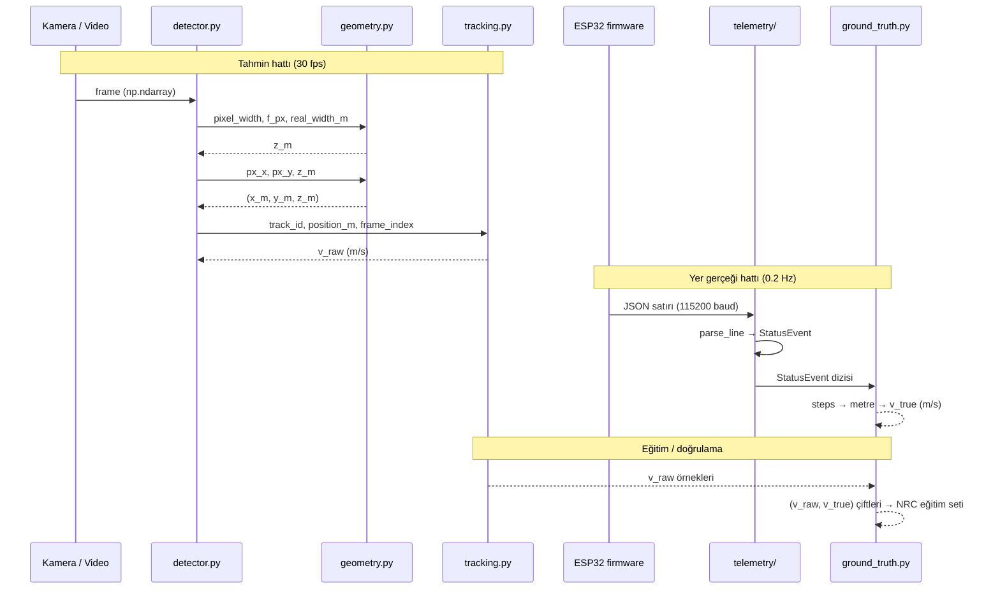

# Modül Sınırları ve Veri Kontratları

Altyapının çalışması için modüller arasındaki veri biçiminin sabitlenmesi gerekir.
Bu rapor, her modülün girdi/çıktı sözleşmesini ve birim sistemini tanımlar.
Sözleşmeler belirsiz kaldığında test yazılamaz ve CI kapısı anlamsız hale gelir.

---

## 1. Birim sistemi kararı

Mevcut kodda iki farklı birim sistemi karışmış durumda:

| Değişken | `kadir.py` | `1_donem_kadir.py` |
| --- | --- | --- |
| fiziksel genişlik | `BALL_WIDTH_CM = 18.5` (cm) | `PLATE_WIDTH_M = 0.520` (m) |
| derinlik `Z` | cm | m |
| hız | `speed_cm_s` (cm/s) | `speed_kmh` (km/h) |
| odak uzaklığı `f` | piksel | piksel |

**Karar:** paket içinde tüm uzunluklar **metre**, tüm hızlar **m/s**, tüm açılar
**radyan**. Dönüşüm yalnızca sınır katmanlarında yapılır:

- İnsan arayüzü (CLI çıktısı, görselleştirme etiketi) → km/h, cm
- Firmware telemetrisi → adım (steps) ve milimetre

Birimler tip ipuçlarında taşınmaz (Python'da pratik değil), bunun yerine
değişken adlarında son ek kullanılır: `z_m`, `v_ms`, `f_px`, `w_px`. Bu kural
`02_kod_kalitesi/01_ruff_linter_formatter.md` içindeki adlandırma bölümünde
zorunlu tutuluyor.

Gerekçe: `δv ∝ Z²·δP` hata yayılımı hesabında cm/m karışımı 100 katlık hata
üretir ve bu hata testlerde yakalanamaz, çünkü her iki taraf da aynı yanlış
birimi kullanır.

---

## 2. Modül kontratları

### 2.1 `geometry.py` — saf matematik, yan etkisiz

```python
def estimate_depth(f_px: float, real_width_m: float, pixel_width_px: float) -> float:
    """Z = (f * W) / P  → metre

    Yükseltir:
        ValueError: pixel_width_px <= 0 veya f_px <= 0 veya real_width_m <= 0
    """

def project_3d(px_x: float, px_y: float, z_m: float,
               f_px: float, optical_center: tuple[float, float]) -> tuple[float, float, float]:
    """2B görüntü düzlemi → 3B uzay (X, Y, Z), metre"""

def focal_length_from_hfov(hfov_rad: float, image_width_px: int) -> float:
    """f = (W_img / 2) / tan(HFOV / 2)  → piksel"""

def focal_length_from_reference(pixel_width_px: float,
                               known_distance_m: float,
                               real_width_m: float) -> float:
    """f = (P * Z) / W  → piksel (dinamik kalibrasyon yolu)"""
```

**Kural:** bu modül `cv2`, `torch`, `ultralytics` import etmez. Yalnızca `math`.
Böylece testler YOLO kurulumu gerektirmeden, milisaniyeler içinde çalışır.

**Mevcut koddan fark:** bugünkü `estimate_depth` `pixel_w <= 0` için `0.0`
döndürüyor. Sıfır derinlik fiziksel olarak anlamsız ve下游 hesapları sessizce
bozuyor. Sözleşme `ValueError` olarak değiştirildi; bu, `A2` numaralı borcun
çözümünün bir parçası.

### 2.2 `calibration.py` — durum tutan, ama salt okunur çıktı veren

```python
@dataclass(frozen=True)
class CameraIntrinsics:
    f_px: float
    optical_center_px: tuple[float, float]
    image_width_px: int
    image_height_px: int
    hfov_rad: float
    source: Literal["datasheet", "dynamic"]   # 85.0 placeholder sorununun izi

@dataclass(frozen=True)
class ScaleReference:
    real_width_m: float
    kind: Literal["license_plate", "headlight_pair", "sports_ball"]
    min_pixel_width: float     # bu referansın güvenilir kaldığı alt sınır
    citation: str              # ölçünün kaynağı (makale tekrarı için şart)
```

`source` alanı bilinçli eklendi: `1_donem_kadir.py` içindeki `hfov=85.0`
değerinin kodda "placeholder" diye yazılı olması, makalede hakemin ilk
soracağı şey. Bu alan sayesinde her çıktı, kalibrasyonun nereden geldiğini
taşır ve `datasheet` olmayan sonuçlar raporlarda işaretlenebilir.

### 2.3 `tracking.py` — kimlik ve hız türetimi

```python
@dataclass
class TrackState:
    last_position_m: tuple[float, float, float]
    last_frame_index: int
    last_speed_ms: float

class SpeedTracker:
    def update(self, track_id: int,
               position_m: tuple[float, float, float],
               frame_index: int) -> float:
        """Anlık 3B hız (m/s) döndürür. İlk çağrıda 0.0."""

    def prune(self, current_frame_index: int, max_age_frames: int = 150) -> int:
        """Silinen iz sayısı döner (test edilebilirlik için)."""
```

Mevcut `_cleanup_history` hiçbir şey döndürmüyor; bu yüzden "bellek temizliği
çalıştı mı?" sorusu test edilemiyor. Dönüş değeri eklenmesi test yazılabilir
hale getirir.

**`PLANLANIYOR` genişleme:** `update` bugün iki nokta arası sonlu fark
(`Δd/Δt`) kullanıyor. Kalman filtresi geldiğinde aynı imza korunacak, yalnızca
iç实现 değişecek. İmzanın sabit kalması, ablation çalışmasında filtre
değişiminin pipeline'ın geri kalanını etkilememesini sağlar.

### 2.4 `detector.py` — YOLO sarmalayıcı

```python
DetectionMode = Literal["ball", "plate", "plate_with_pose"]

@dataclass(frozen=True)
class Detection:
    track_id: int | None
    bbox_xyxy: tuple[int, int, int, int]
    confidence: float
    pixel_width: float
    center_px: tuple[float, float]
    aspect_ratio: float        # NRC girdilerinden biri
    y_normalized: float        # NRC girdilerinden biri (y2 / image_height)

class ObjectDetector:
    def __init__(self, model_path: Path, mode: DetectionMode,
                 target_class_ids: Sequence[int] | None = None) -> None: ...
    def detect(self, frame: np.ndarray) -> list[Detection]: ...
    def track(self, frame: np.ndarray) -> list[Detection]: ...
```

`Detection` alanları doğrudan NRC'nin 5 girdisinden üçünü taşıyor
(`aspect_ratio`, `y_normalized`, `confidence`). Bu bilinçli: NRC
`PLANLANIYOR` olsa da veri sözleşmesi bugünden kurulursa, model eklendiğinde
pipeline'da hiçbir değişiklik gerekmez.

`track_id: int | None` olması önemli. YOLO `track()` çağrısı ilk karede
`boxes.id is None` döndürebiliyor; mevcut kod bu durumda tüm kareyi atlıyor:

```python
if not results or not results[0].boxes or results[0].boxes.id is None:
    return detections
```

Bu, tespit yapıldığı halde kimlik atanmadığı için nesnenin tamamen kaybolması
demek. Sözleşme `None`'a izin verince, kimliksiz tespitler de hız hesabı
dışında kullanılabilir (ör. kare başına nesne sayımı metrikleri).

### 2.5 `telemetry/protocol.py` — ESP32 JSON şeması

Firmware'in gerçekten ürettiği dört olay tipi, `firmware/src/main.cpp`
içindeki `Serial.print` çağrılarından birebir çıkarıldı:

```python
@dataclass(frozen=True)
class StartupEvent:
    event: Literal["startup"]
    message: str
    max_speed: float                 # step/s

@dataclass(frozen=True)
class DirectionChangeEvent:
    event: Literal["direction_change"]
    new_target_steps: int
    new_max_speed: float
    acceleration: float

@dataclass(frozen=True)
class StatusEvent:
    event: Literal["status"]
    elapsed_time_ms: int
    current_position: int            # step

@dataclass(frozen=True)
class CompleteEvent:
    event: Literal["complete"]
    message: str

TelemetryEvent = StartupEvent | DirectionChangeEvent | StatusEvent | CompleteEvent

def parse_line(line: str) -> TelemetryEvent | None:
    """Tek satır JSON → tipli olay. Bozuk/kısmi satırda None döner, yükseltmez."""
```

`None` dönüşü bilinçli: seri port okuması satır ortasında bölünebilir.
`listen.py`'deki mevcut davranış ham baytı dosyaya yazmak olduğu için bu
durum bugün hiç ele alınmıyor. Gerçek `serial.log` dosyası 23 bayt — yani
kayıt neredeyse boş, ayrıştırma hiç denenmemiş.

**Kritik sınır:** `parse_line` kısmi satırda istisna fırlatmamalı. Aksi halde
5 dakikalık bir deney, tek bir bölünmüş satır yüzünden kaybolur.

### 2.6 `telemetry/ground_truth.py` — adım → fiziksel hız

```python
STEPS_PER_MM: Final[int] = 400          # firmware'den, main.cpp:26
TRAVEL_DISTANCE_MM: Final[int] = 500    # firmware'den, main.cpp:27

def steps_to_metres(steps: int, steps_per_mm: int = STEPS_PER_MM) -> float: ...
def ground_truth_speed(status_events: Sequence[StatusEvent]) -> list[tuple[float, float]]:
    """[(t_saniye, v_ms), ...] — ardışık status olaylarından türetilir"""
```

Bu modül makalenin yer gerçeği (ground truth) kaynağı. `status` olayları
5000 ms arayla geldiği için yer gerçeği örnekleme hızı 0.2 Hz. Video tarafı
30 fps. İki akışın eşlenmesi `tests/integration/test_ground_truth_sync.py`
konusu ve zaman damgası senkronizasyonu gerektiriyor — bugün iki tarafta da
ortak bir saat kaynağı yok. Bu, `PLANLANIYOR` kategorisindeki en riskli açık.

---

## 3. Veri akışı



İki hattın birleştiği tek nokta en alttaki `(v_raw, v_true)` çifti üretimi.
NRC'nin 5 girdisinden `v_raw` tahmin hattından, etiket (`v_true`) yer gerçeği
hattından gelir. Diğer dört girdi (`w_px`, `y_norm`, `AR`, `conf`) tamamen
`Detection` veri sınıfından gelir, yani ek donanım gerektirmez.

---

## 4. Sınır ihlali kuralları

CI'da otomatik denetlenebilecek import kuralları:

| Modül | Import edebilir | Import edemez |
| --- | --- | --- |
| `geometry.py` | `math`, `numpy` | `cv2`, `torch`, `ultralytics`, `serial` |
| `calibration.py` | `math`, `geometry` | `cv2`, `torch`, `ultralytics` |
| `tracking.py` | `numpy`, `scipy`, `geometry` | `cv2`, `torch`, `ultralytics` |
| `telemetry/*` | `serial`, `json`, `pathlib` | `cv2`, `torch`, `ultralytics` |
| `detector.py` | `numpy`, `ultralytics`, `geometry` | `cv2.imshow` |
| `visualization.py` | `cv2`, hepsi | — |
| `cli.py` | hepsi | — |

Bu tablonun amacı: testlerin %80'inin `torch` ve `ultralytics` kurulmadan
çalışabilmesi. CI süresini belirleyen şey bu ayrım, çünkü `torch` CPU tekerleği
bile ~200 MB.

Denetim yolu — `import-linter` aracı:

```toml
[tool.importlinter]
root_packages = ["vehicle_speed"]

[[tool.importlinter.contracts]]
name = "geometry stays pure"
type = "forbidden"
source_modules = ["vehicle_speed.geometry"]
forbidden_modules = ["cv2", "torch", "ultralytics", "serial"]

[[tool.importlinter.contracts]]
name = "telemetry independent of vision"
type = "forbidden"
source_modules = ["vehicle_speed.telemetry"]
forbidden_modules = ["cv2", "torch", "ultralytics"]
```

`import-linter` isteğe bağlı bir katman. Zorunlu değil ama kurulursa tablo
elle denetlenmek zorunda kalmaz. Karar `07_uygulama_yol_haritasi/01_adim_adim_uygulama.md`
içinde Faz 3'e opsiyonel adım olarak eklendi.

---

## 5. Kontratlardaki açık noktalar

Dürüst kayıt — bu rapor şu soruları **çözmüyor**, uygulama sırasında karar
verilmesi gerekiyor:

1. **Zaman senkronizasyonu.** Video kare indeksi ile ESP32 `elapsed_time_ms`
   değeri ortak bir saate bağlı değil. Kare zaman damgası `cap.get(cv2.CAP_PROP_POS_MSEC)`
   ile alınabilir ama bu video dosyası içindir; canlı kamerada sürüklenme olur.
   Donanım tarafında tetikleyici (trigger) sinyali yok. Çözüm adayları: deney
   başlangıcında eşzamanlı el çırpma/LED flaş, veya firmware'e bir başlangıç
   işaretini algılayan ek giriş.
2. **`status` olayının örnekleme yetersizliği.** 5000 ms aralık, 30 fps videoya
   karşı 250 kat daha seyrek. Yer gerçeği eğrisi bu çözünürlükte NRC eğitimi
   için yetersiz kalabilir. `firmware/src/main.cpp` içindeki 5000 değeri
   düşürülmeli — ama `Serial.print` çağrısı `loop()` içinde bloklar, çok sık
   loglama adım zamanlamasını bozar. Ölçülmesi gereken bir ödünleşim.
3. **`ScaleReference.min_pixel_width`.** `1_donem_kadir.py` içinde 15.0 piksel
   eşiği var (`if pixel_w < 15.0`). Bu değerin kaynağı belgesiz. Plaka 15
   pikselin altına düştüğünde far referansına geçiliyor, ama far referansının
   kendi alt sınırı tanımsız.
