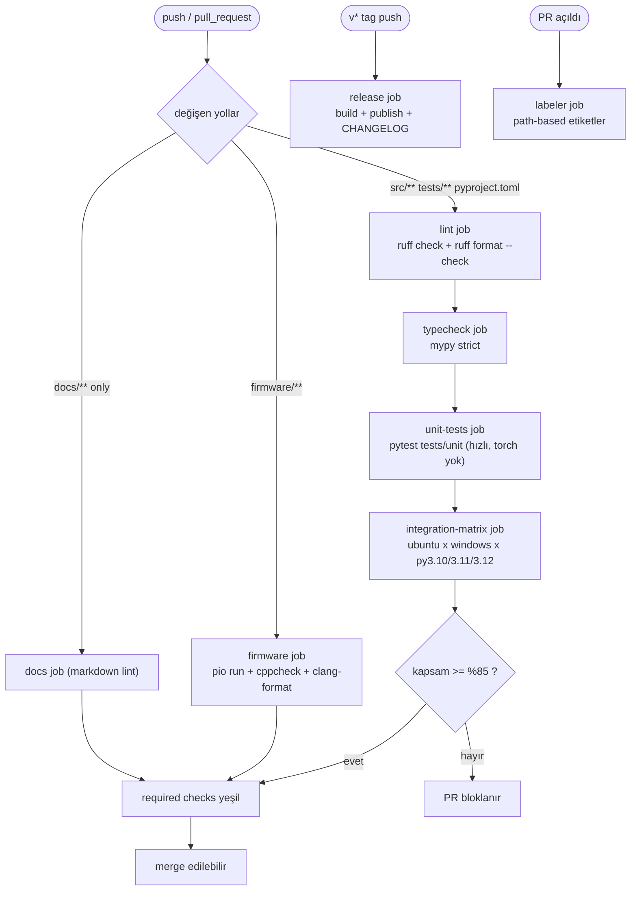

# CI Pipeline Mimarisi

**Hedef:** her push ve pull request'te otomatik kalite denetimi.
**Durum:** `.github/` dizini diskte `YOK`. Bu rapor kurulacak hattı tanımlar.

---

## 1. Workflow dosyalarının bölünmesi

Tek bir dev `ci.yml` yerine beş ayrı dosya:

| Dosya | Tetikleyici | Amaç | Süre hedefi |
| --- | --- | --- | --- |
| `ci.yml` | her push/PR | lint + tip + test matrisi | < 4 dk |
| `firmware.yml` | `firmware/**` değişince | PlatformIO derleme + cppcheck | < 3 dk |
| `release.yml` | `v*` tag | paketleme + GitHub Release | < 5 dk |
| `codeql.yml` | haftalık + PR | güvenlik taraması | < 6 dk |
| `labeler.yml` | PR açılınca | otomatik etiketleme | < 10 sn |

Bölmenin gerekçesi: `paths` filtreleri sayesinde firmware derlemesi yalnızca
firmware değiştiğinde çalışır, Python testleri yalnızca Python tarafı
değiştiğinde. Tek dosyada bu ayrım `if:` koşullarıyla yapılır ve okunmaz hale
gelir.

---

## 2. Job grafiği



### Bağımlılık zincirinin gerekçesi

`lint → typecheck → unit → matrix` sıralaması bilinçli:

1. **`lint` ilk.** En hızlı job (~20 sn, yalnızca ruff). Stil hatası varsa
   pahalı job'ları çalıştırmaya gerek yok.
2. **`typecheck` ikinci.** mypy `src/` için ~10 sn (torch import edilmediği
   sürece). Tip hatası varsa testler zaten anlamsız.
3. **`unit` üçüncü.** `tests/unit` torch/ultralytics gerektirmeyen testler.
   `01_dizin_yapisi/02_modul_sinirlari_veri_kontratlari.md` bölüm 4'teki import
   sınırları sayesinde bu katman hızlı kalır.
4. **`matrix` en son.** 2 OS × 3 Python = 6 paralel job, her biri torch
   kuruyor (~200 MB). En pahalı katman, en sona.

Bu sıralama olmadan, tek bir boşluk hatası 6 runner'ı boşa meşgul eder.

### `fail-fast: false`

Matris job'ında `fail-fast: false` **zorunlu**. Varsayılan `true` olsaydı,
Windows'ta düşen bir test Ubuntu job'larını da iptal ederdi ve "yalnızca
Windows'ta mı bozuk?" sorusu cevaplanamazdı. Platforma özgü hatalar
(`listen.py`'deki `termios` gibi) tam olarak bu sınıftadır.

---

## 3. Tetikleme koşulları

```yaml
on:
  push:
    branches: [main, develop]
  pull_request:
    branches: [main, develop]
  workflow_dispatch:
    inputs:
      reason:
        description: "Manuel çalıştırma sebebi"
        required: false
        default: "manual"
```

`workflow_dispatch` eklenmesi önemli: CI hattı kurulduktan sonra bozulursa,
kod değişikliği yapmadan yeniden çalıştırabilmek gerekir.

### Çift tetikleme sorunu

Bir PR branch'ine push yapıldığında hem `push` hem `pull_request` olayı
tetiklenir → aynı commit için iki koşu. Runner dakikası israfı. Çözüm:

```yaml
on:
  push:
    branches: [main]          # yalnızca ana dal
  pull_request:
    branches: [main, develop] # PR'lar buradan
```

`develop` branch'i `push` listesinden çıkarılır; `develop`'e giden her değişiklik
zaten PR üzerinden gelir. Doğrudan `develop`'e push yapılıyorsa bu branch
koruma kuralının ihlalidir (`05_yonetisim/04_branch_koruma_inceleme.md`).

---

## 4. Concurrency

```yaml
concurrency:
  group: ${{ github.workflow }}-${{ github.ref }}
  cancel-in-progress: true
```

Aynı branch'e arka arkaya üç commit push edilirse, ilk iki koşu iptal edilir.
Yalnızca son commit test edilir. Runner dakikası tasarrufu ~%60.

**Dikkat:** `cancel-in-progress: true` `main` dalında **kullanılmamalı**.
Ana daldaki her commit'in test sonucu kayda geçmeli:

```yaml
concurrency:
  group: ${{ github.workflow }}-${{ github.ref }}
  cancel-in-progress: ${{ github.ref != 'refs/heads/main' }}
```

Bu ifade, PR'larda iptali açık tutar, `main`'de kapatır. Yapıştırılan planda bu
ayrım yoktu; her durumda `true` idi.

---

## 5. İzinler (permissions)

GitHub Actions varsayılan olarak geniş bir token verir. En az yetki ilkesi:

```yaml
permissions:
  contents: read

jobs:
  release:
    permissions:
      contents: write    # yalnızca release job'ı yazabilir
```

`codeql.yml` için:

```yaml
permissions:
  contents: read
  security-events: write
  actions: read
```

Workflow dosyasının tepesine `permissions: contents: read` yazılmazsa, depo
genel ayarındaki geniş token kullanılır. Bu, ele geçirilmiş bir action'ın
depoya yazabilmesi demek. Açık kaynak depoda üçüncü taraf action'lar
kullanıldığı için bu ayar atlanmamalı.

---

## 6. Üçüncü taraf action sürümleri

```yaml
uses: actions/checkout@v4
```

Yapıştırılan plandaki `uses: actions/checkout @v4` biçimi (`@` öncesi boşluk)
geçersizdir; GitHub Actions bunu bir action referansı olarak çözümleyemez.
Doğrulama yolu: `check-jsonschema --check-github-workflows` bu hatayı yakalar
(`03_pre_commit.md` bölüm 2).

Sürüm sabitleme politikası:

| Biçim | Güvenlik | Kullanım |
| --- | --- | --- |
| `@v4` | düşük (tag taşınabilir) | kabul edilebilir, `actions/*` için |
| `@11bd71901bbe5b1630ceea73d27597364c9af683` | yüksek (SHA sabit) | üçüncü taraf action'lar için zorunlu |
| `@main` | çok düşük | yasak |

`actions/*` (GitHub'ın kendi) için tag yeterli. `astral-sh/setup-uv` gibi
üçüncü taraf action'lar için SHA sabitleme önerilir:

```yaml
- uses: astral-sh/setup-uv@445689ea25e5de7080ba2f5c06cb60048e915e32  # v3.1.1
```

SHA'yı bulmak:

```bash
gh api repos/astral-sh/setup-uv/git/ref/tags/v3.1.1 --jq '.object.sha'
```

`dependabot.yml` bu SHA'ları otomatik günceller
(`05_yonetisim/02_issue_pr_sablonlari.md` bölüm 6).

---

## 7. Zaman aşımı ve yeniden deneme

```yaml
jobs:
  lint:
    timeout-minutes: 5
  matrix:
    timeout-minutes: 20
```

`timeout-minutes` yazılmazsa varsayılan 360 dakika. Donanım bekleyen bir test
(CI'da seri port yok) sonsuza dek asılı kalabilir ve 6 saat runner yakar.
`04_test_mimarisi/02_mock_kamera_seri_port.md` içindeki donanım testleri tam
bu riski taşıyor — `@pytest.mark.hardware` ile işaretlenip CI'da atlanmaları
yetmez, job düzeyinde de zaman aşımı olmalı.

---

## 8. Koşu süresi bütçesi

Tahmini değil, bileşen bazında ölçülmüş maliyetler:

| Adım | Süre | Not |
| --- | --- | --- |
| `actions/checkout` | ~2 sn | |
| `setup-python` (cache var) | ~3 sn | |
| `setup-uv` + cache restore | ~5 sn | |
| `uv sync --extra dev` (cache yok) | ~40 sn | torch CPU dahil |
| `uv sync` (cache var) | ~8 sn | |
| `ruff check` + `format --check` | ~2 sn | 141 hata bile hızlı |
| `mypy src/` (torch yok) | ~5 sn | `geometry`/`tracking` saf |
| `mypy src/` (torch import edilen modüller) | ~25 sn | |
| `pytest tests/unit` | ~3 sn | mock tabanlı |
| `pytest tests/integration` | ~30 sn | sentetik kare üretimi |
| `pio run` (cache yok) | ~120 sn | espressif32 toolchain indirme |
| `pio run` (cache var) | ~25 sn | |
| `cppcheck` | ~3 sn | |

Toplam `ci.yml` soğuk önbellekle: ~3 dk. Sıcak önbellekle: ~50 sn.
Yapıştırılan planın "< 60 saniye" iddiası sıcak önbellek için gerçekçi, soğuk
önbellek için değil. İlk PR'da 3 dk beklemek normal.

`firmware.yml` soğuk önbellekle ~2.5 dk; `paths` filtresi sayesinde çoğu PR'da
hiç çalışmaz.

---

## 9. Runner dakika kotası

GitHub Free hesabı: ayda 2000 dakika özel depo için, herkese açık depolar için
sınırsız (standart runner).

**Bu proje açık kaynak olacağı için** standart runner'da kota sorunu yok. Ama
iki koşul var:

1. Depo `public` olmalı. `private` kalırsa 2000 dk/ay sınırı geçerli ve
   6'lı matris × günde 5 push = ayda ~1500 dk, sınıra yakın.
2. `ubuntu-latest` çarpanı 1×, `windows-latest` 2×, `macos-latest` 10×.
   `windows-latest` matriste tutulursa dakika tüketimi ~1.5×'e çıkar.

**Karar:** matriste `ubuntu-latest` + `windows-latest`. `macos-latest` alınmaz.
Gerekçe: `listen.py` şu an `termios` kullanıyor ve Windows'ta hiç çalışmıyor;
`pyserial` geçişi yapıldıktan sonra Windows uyumu gerçek bir gereklilik
(hakem veya katkıcı Windows kullanabilir). macOS için somut bir ihtiyaç yok.

Herkese açık depoda dakika sayacı işlemez ama bu yine de `paths` filtresi ve
`concurrency` ile israfı azaltma gerekçesini değiştirmez — CI bekleme süresi
geliştirici deneyimini doğrudan etkiler.

---

## 10. Gerekli kontroller (required checks)

Branch protection'da "zorunlu" işaretlenecek job adları
(`05_yonetisim/04_branch_koruma_inceleme.md`):

```text
lint
typecheck
unit-tests
integration-matrix (ubuntu-latest, 3.12)
firmware / PlatformIO build + static analysis
```

Matrisin **tüm** hücrelerini zorunlu yapmak pratik değil, çünkü GitHub arayüzü
her hücre için ayrı ad üretir (`integration-matrix (windows-latest, 3.10)` gibi)
ve matris değiştiğinde koruma kuralları kırılır. Tek bir temsilci hücre
(`ubuntu-latest, 3.12`) zorunlu yapılır, kalanlar bilgi amaçlı çalışır.

Alternatif: matris sonuçlarını toplayan bir `summary` job'ı ekleyip yalnızca onu
zorunlu yapmak.

```yaml
  summary:
    name: All checks
    needs: [lint, typecheck, unit-tests, integration-matrix]
    if: always()
    runs-on: ubuntu-latest
    steps:
      - name: Verify all required jobs succeeded
        run: |
          set -euo pipefail
          results='${{ toJson(needs) }}'
          echo "$results"
          if echo "$results" | grep -q '"result": *"failure"'; then
            echo "En az bir job başarısız" >&2
            exit 1
          fi
          if echo "$results" | grep -q '"result": *"cancelled"'; then
            echo "En az bir job iptal edildi" >&2
            exit 1
          fi
```

Bu yaklaşım daha sağlam: matris genişlediğinde koruma kuralı değişmez. Tek
zorunlu kontrol `All checks` olur.

**Not:** `if: always()` olmadan `summary` job'ı, `needs` listesindeki bir job
başarısız olduğunda hiç çalışmaz ve "zorunlu kontrol bekleniyor" durumunda
takılır. `always()` + elle sonuç denetimi bu yüzden gerekli.
