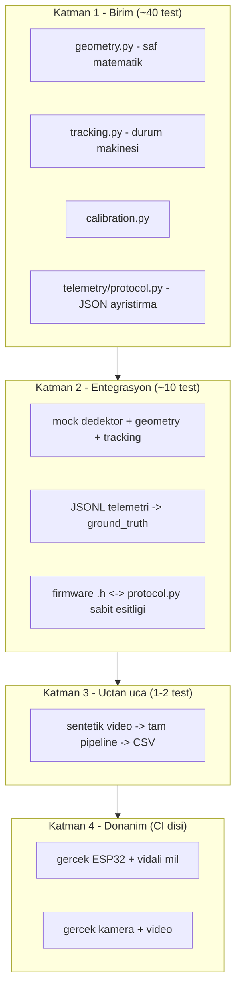

# Test Piramidi ve Kapsam Stratejisi

**Durum:** `tests/` dizini diskte `YOK`. `pytest` kurulu değil. Sıfır test var.
Bu rapor kurulacak test mimarisini tanımlar.

---

## 1. Katmanlar



| Katman | Adet hedefi | Süre hedefi | Donanım | torch | CI |
| --- | --- | --- | --- | --- | --- |
| Birim | ~40 | < 3 sn | yok | yok | her push |
| Entegrasyon | ~10 | < 30 sn | mock | yok | her push |
| Uçtan uca | 1-2 | < 60 sn | sentetik | **gerekli** | matris |
| Donanım | ~5 | sınırsız | **gerekli** | — | **CI dışı** |

Katman 1-2'nin torch gerektirmemesi, `03_ci_cd/02_ci_workflow_adimlari.md`
bölüm 2.4'teki `--no-install-package torch` optimizasyonunun temelidir.

---

## 2. Dizin yapısı

```text
tests/
├── conftest.py                       # ortak fixture'lar
├── unit/
│   ├── test_geometry.py
│   ├── test_tracking.py
│   ├── test_calibration.py
│   └── test_telemetry_protocol.py
├── integration/
│   ├── test_pipeline_offline.py
│   ├── test_ground_truth_sync.py
│   └── test_firmware_contract.py
├── e2e/
│   └── test_full_pipeline_synthetic.py
├── hardware/                         # CI'da atlanır
│   └── test_esp32_live.py
└── fixtures/
    ├── telemetry_sample.jsonl        # gerçek cihazdan kısa kayıt
    ├── telemetry_malformed.jsonl     # bozuk/kısmi satırlar
    └── synthetic_frames/             # üretilmiş PNG'ler
```

`hardware/` ayrı dizin çünkü `pytest` yapılandırmasında tek satırla dışlanır:

```toml
[tool.pytest.ini_options]
testpaths = ["tests/unit", "tests/integration", "tests/e2e"]
addopts = "-ra --strict-markers --strict-config"
markers = [
    "hardware: fiziksel ESP32 veya kamera gerektirir",
    "slow: 5 saniyeden uzun süren testler",
]
```

`testpaths`'e `tests/hardware` yazılmaz → CI'da hiç toplanmaz. Yerelde
donanımla çalıştırılacaksa açıkça belirtilir:

```bash
uv run pytest tests/hardware -m hardware -v
```

İkinci koruma katmanı: `conftest.py` içinde otomatik atlama.

```python
def pytest_collection_modifyitems(config: pytest.Config, items: list[pytest.Item]) -> None:
    if config.getoption("--run-hardware", default=False):
        return
    skip = pytest.mark.skip(reason="fiziksel donanım gerekli; --run-hardware ile etkinleştir")
    for item in items:
        if "hardware" in item.keywords:
            item.add_marker(skip)

def pytest_addoption(parser: pytest.Parser) -> None:
    parser.addoption("--run-hardware", action="store_true", default=False,
                     help="fiziksel donanım testlerini çalıştır")
```

Yalnızca `testpaths`'e güvenmek kırılgandır: biri `pytest tests/` yazarsa
donanım testleri toplanır ve seri port beklerken asılı kalır. İki katman şart.

---

## 3. Birim testler: `geometry.py`

Bu modül saf matematik olduğu için en yüksek değer/en düşük maliyet oranına
sahip. Hedef kapsam: **%100**.

### 3.1 Pinhole derinlik

```python
import math
import pytest
from vehicle_speed.geometry import estimate_depth


@pytest.mark.parametrize(
    ("f_px", "real_width_m", "pixel_width_px", "expected_m"),
    [
        (1200.0, 0.52, 100.0, 6.24),        # tipik plaka, 25 m değil 6.24 m
        (1200.0, 1.50, 100.0, 18.0),        # far referansı
        (1200.0, 0.52, 10.0, 62.4),         # uzak: 10 px -> 62 m
        (600.0, 0.52, 100.0, 3.12),         # yarım odak -> yarı derinlik
    ],
)
def test_estimate_depth_matches_pinhole_formula(
    f_px: float, real_width_m: float, pixel_width_px: float, expected_m: float
) -> None:
    assert estimate_depth(f_px, real_width_m, pixel_width_px) == pytest.approx(expected_m)


def test_estimate_depth_is_inversely_proportional_to_pixel_width() -> None:
    """Z ~ 1/P ilişkisi: piksel genişliği yarıya inince derinlik iki katına çıkar."""
    near = estimate_depth(1200.0, 0.52, 200.0)
    far = estimate_depth(1200.0, 0.52, 100.0)
    assert far == pytest.approx(2.0 * near)


@pytest.mark.parametrize("bad", [0.0, -1.0, -100.5])
def test_estimate_depth_rejects_non_positive_pixel_width(bad: float) -> None:
    """Mevcut kod 0.0 döndürüyordu; sözleşme ValueError olarak değişti."""
    with pytest.raises(ValueError, match="positive values required"):
        estimate_depth(1200.0, 0.52, bad)


def test_estimate_depth_rejects_non_positive_focal_length() -> None:
    with pytest.raises(ValueError, match="positive values required"):
        estimate_depth(0.0, 0.52, 100.0)
```

Üçüncü test **davranış değişikliğini** belgeliyor: mevcut `estimate_depth`
`pixel_w <= 0.0` için `0.0` döndürüyor (`kadir.py:60`), yeni sözleşme
`ValueError` yükseltiyor. Gerekçe: `00_durum_analizi/02_teknik_borc_ve_hatalar.md` A2.

### 3.2 Z² hata yayılımı — makale çekirdeği

Bu test, slayt 18'deki `δv ∝ Z²·δP` iddiasının **kod düzeyinde kanıtıdır**.
Makalede formül olarak yazılan şey burada sayısal olarak doğrulanır.

```python
def test_pixel_jitter_error_grows_quadratically_with_depth() -> None:
    """±1 px titremenin derinlik hatası Z^2 ile büyür (δZ = Z²·δP/(W·f))."""
    f_px, real_width_m = 1200.0, 0.52
    jitter_px = 1.0

    errors = {}
    for pixel_width_px in (200.0, 100.0, 50.0, 25.0):
        nominal = estimate_depth(f_px, real_width_m, pixel_width_px)
        jittered = estimate_depth(f_px, real_width_m, pixel_width_px + jitter_px)
        errors[pixel_width_px] = abs(jittered - nominal)

    # piksel genişliği yarıya indikçe hata ~4 katına çıkmalı
    ratios = [
        errors[100.0] / errors[200.0],
        errors[50.0] / errors[100.0],
        errors[25.0] / errors[50.0],
    ]
    for ratio in ratios:
        assert 3.0 < ratio < 5.0, f"beklenen ~4x büyüme, elde edilen {ratio:.2f}"
```

Bu testin değeri: hakem "Z² iddianız nereden geliyor?" diye sorduğunda,
çalıştırılabilir bir kanıt gösterilebilir. Aynı zamanda bir **regresyon
kilitidir** — biri `estimate_depth`'i lineer bir modele değiştirirse test düşer.

### 3.3 Kalibrasyon yolları

```python
def test_focal_length_from_reference_roundtrips_with_depth() -> None:
    """Dinamik kalibrasyon: f türet, sonra aynı Z'yi geri al."""
    known_distance_m = 1.83          # kadir.py VIDEO_SOURCES'daki 183.0 cm
    pixel_width_px = 121.0
    real_width_m = 0.185             # BALL_WIDTH_CM = 18.5

    f_px = focal_length_from_reference(pixel_width_px, known_distance_m, real_width_m)
    recovered = estimate_depth(f_px, real_width_m, pixel_width_px)
    assert recovered == pytest.approx(known_distance_m, rel=1e-9)


def test_focal_length_from_hfov_matches_datasheet() -> None:
    """f = (W/2) / tan(HFOV/2). 1920 px ve 85° için ~1268 px."""
    f_px = focal_length_from_hfov(math.radians(85.0), 1920)
    assert f_px == pytest.approx(960.0 / math.tan(math.radians(42.5)), rel=1e-9)
```

İkinci test, `1_donem_kadir.py` içindeki `hfov=85.0` placeholder'ını belgeler.
Test geçiyor ama 85.0 değerinin kendisi doğrulanmış değil — bu bir **test
kapsamı yanılsaması** örneği ve `02_kabul_kriterleri.md` içinde dürüstçe
kaydedildi.

---

## 4. Birim testler: `tracking.py`

```python
def test_first_update_returns_zero_speed() -> None:
    tracker = SpeedTracker()
    assert tracker.update(track_id=1, position_m=(0.0, 0.0, 10.0), frame_index=0) == 0.0


def test_constant_velocity_converges_to_true_speed() -> None:
    """30 fps, 10 m/s sabit hız: 1.0 m/kare yer değiştirme."""
    tracker = SpeedTracker()
    speeds = []
    for i in range(20):
        speeds.append(tracker.update(1, (0.0, 0.0, 10.0 - i * 1.0), i))
    assert speeds[-1] == pytest.approx(30.0, rel=1e-6)   # 1.0 m * 30 fps


def test_non_monotonic_frame_index_returns_cached_speed() -> None:
    """frame_diff <= 0 ise mevcut kod cache'den döndürüyor; bu davranış kilitlenir."""
    tracker = SpeedTracker()
    tracker.update(1, (0.0, 0.0, 10.0), frame_index=10)
    tracker.update(1, (0.0, 0.0, 5.0), frame_index=5)     # geriye giden indeks
    assert tracker.update(1, (0.0, 0.0, 5.0), frame_index=5) == 0.0


def test_math_interval_spacing_reflected_in_speed() -> None:
    """MATH_INTERVAL=5: ölçümler 5 kare arayla gelir, delta_t buna göre ölçeklenir."""
    tracker = SpeedTracker()
    tracker.update(1, (0.0, 0.0, 20.0), frame_index=0)
    v = tracker.update(1, (0.0, 0.0, 15.0), frame_index=5)
    assert v == pytest.approx(5.0 / (5 / 30.0), rel=1e-6)   # 30 m/s


def test_prune_removes_stale_tracks_and_returns_count() -> None:
    tracker = SpeedTracker()
    for tid in range(5):
        tracker.update(tid, (0.0, 0.0, 10.0), frame_index=0)
    tracker.update(0, (0.0, 0.0, 9.0), frame_index=200)     # yalnızca 0 güncel
    removed = tracker.prune(current_frame_index=200, max_age_frames=150)
    assert removed == 4
    assert tracker.active_ids() == {0}
```

Son test, mevcut `_cleanup_history`'nin dönüş değeri olmadığı için **yazılamaz**
durumda. İmza değişikliği (`01_dizin_yapisi/02_modul_sinirlari_veri_kontratlari.md`
bölüm 2.3) test edilebilirliği doğrudan sağlıyor.

---

## 5. Birim testler: `telemetry/protocol.py`

Fixture dosyası `tests/fixtures/telemetry_sample.jsonl`, gerçek firmware
çıktısından üretilmeli (elle yazılmamalı):

```bash
# gerçek cihazdan kayıt al
cd firmware && pio device monitor --baud 115200 | tee /tmp/raw.log
# ilk 50 satırı fixture'a dönüştür
grep -m 50 '^{' /tmp/raw.log > tests/fixtures/telemetry_sample.jsonl
```

Mevcut `serial.log` yalnızca 23 bayt, yani kullanılabilir kayıt yok. Fixture
üretilmeden bu testler yazılamaz — bu bir **engel**, `01_adim_adim_uygulama.md`
içinde donanım gerektiren ön koşul olarak işaretlendi.

Geçici çözüm: `firmware/src/main.cpp` içindeki `Serial.print` çağrılarından
birebir türetilmiş sentetik örnekler.

```python
REALISTIC_LINES = [
    '{"event": "startup", "message": "5 dakikalik test basladi", "max_speed": 1000.00}',
    '{"event": "status", "elapsed_time_ms": 5000, "current_position": 45320}',
    '{"event": "direction_change", "new_target_steps": 0, "new_max_speed": 1500.00, "acceleration": 750.00}',
    '{"event": "complete", "message": "300000ms doldu. Motor durduruldu."}',
]


@pytest.mark.parametrize(("line", "expected_type"), zip(REALISTIC_LINES, [
    StartupEvent, StatusEvent, DirectionChangeEvent, CompleteEvent], strict=True))
def test_parse_line_dispatches_to_correct_type(line: str, expected_type: type) -> None:
    event = parse_line(line)
    assert isinstance(event, expected_type)


@pytest.mark.parametrize("bad_line", [
    "",                                    # boş
    "\n",                                  # yalnızca satır sonu
    '{"event": "status", "elapsed_time',   # KISMİ — seri okuma ortasında bölündü
    "not json at all",
    '{"event": "unknown_type"}',           # bilinmeyen olay
    '{"event": "status"}',                 # eksik zorunlu alanlar
    b"\xff\xfe".decode("utf-8", "replace"),# bozuk bayt
])
def test_parse_line_returns_none_instead_of_raising(bad_line: str) -> None:
    """5 dakikalık deney tek bozuk satır yüzünden kaybolmamalı."""
    assert parse_line(bad_line) is None
```

Üçüncü satırdaki kısmi JSON vakası gerçek: `listen.py` `os.read(fd, 256)` ile
256 baytlık parçalar okuyor ve satır sınırına bakmıyor. Uzun bir JSON 256
baytı aşarsa iki parçaya bölünür. `parse_line`'ın `None` döndürmesi bu yüzden
şart; ama **bölünen satırın yeniden birleştirilmesi** de gerekiyor, aksi halde
veri kaybolur. Bu, `serial_reader.py`'nin sorumluluğu:

```python
def test_reader_reassembles_split_lines() -> None:
    """256 baytlık okuma sınırında bölünen satır yeniden birleştirilmeli."""
    long_line = '{"event": "status", "elapsed_time_ms": 5000, "current_position": 45320}\n'
    chunks = [long_line[:40], long_line[40:]]
    reader = TelemetryReader(chunk_iter=iter(chunks))
    events = list(reader.events())
    assert len(events) == 1
    assert isinstance(events[0], StatusEvent)
```

---

## 6. Entegrasyon testleri

### 6.1 Firmware ↔ Python sözleşmesi

```python
def test_schema_constants_match_firmware_header() -> None:
    header = (REPO_ROOT / "firmware" / "include" / "telemetry_protocol.h").read_text()
    values = {
        name: int(m.group(1))
        for name in ("STEPS_PER_MM", "TRAVEL_DISTANCE_MM", "TELEMETRY_SCHEMA_VERSION")
        if (m := re.search(rf"#define\s+{name}\s+(\d+)", header))
    }
    assert values["STEPS_PER_MM"] == protocol.STEPS_PER_MM == 400
    assert values["TRAVEL_DISTANCE_MM"] == protocol.TRAVEL_DISTANCE_MM == 500
    assert values["TELEMETRY_SCHEMA_VERSION"] == protocol.SCHEMA_VERSION
```

Bu test firmware derlemesi gerektirmez, yalnızca başlık dosyasını okur. İki
dil arasındaki tek otomatik bağ. Gerekçe: `02_kod_kalitesi/04_firmware_c_statik_analiz.md` bölüm 7.

### 6.2 Yer gerçeği dönüşümü

```python
def test_ground_truth_speed_from_status_events() -> None:
    """400 step/mm, 5000 ms arayla status. 45320 -> 17000 step = 28320 step fark."""
    events = [
        StatusEvent("status", elapsed_time_ms=5000, current_position=45320),
        StatusEvent("status", elapsed_time_ms=10000, current_position=17000),
    ]
    series = ground_truth_speed(events)
    assert len(series) == 1
    t_s, v_ms = series[0]
    assert t_s == pytest.approx(10.0)
    # |28320 step| / 400 step_per_mm = 70.8 mm = 0.0708 m, 5 sn'de -> 0.01416 m/s
    assert v_ms == pytest.approx(0.0708 / 5.0, rel=1e-6)
```

Bu hız çok düşük (0.014 m/s) çünkü `status` olayları 5 saniyede bir geliyor.
**Bu, gerçek bir ölçüm çözünürlüğü sorunudur**: `02_modul_sinirlari_veri_kontratlari.md`
bölüm 5, madde 2'de kayıtlı. Test sorunu belgelemek için değerli — beklenen
değerin ne kadar küçük olduğunu gösteriyor.

---

## 7. Uçtan uca test

```python
@pytest.mark.slow
def test_full_pipeline_on_synthetic_frames(tmp_path: Path) -> None:
    """Mock dedektör + gerçek geometry/tracking. torch gerektirir, video gerektirmez."""
    detections = synthetic_approaching_object(
        frames=30, start_pixel_width=200.0, end_pixel_width=100.0, fps=30.0
    )
    results = run_pipeline(detections, intrinsics=TEST_INTRINSICS)
    assert len(results) > 0
    assert all(math.isfinite(r.speed_ms) for r in results)
    assert all(r.speed_ms >= 0.0 for r in results)
```

`synthetic_approaching_object` gerçek video üretmez; `Detection` nesneleri
listesi üretir. Böylece `cv2.VideoCapture`, video dosyası ve YOLO model
ağırlığı gerekmez. torch yalnızca `detector.py` import edildiği için gerekir;
mock dedektör kullanılırsa o da kalkar.

**Bilinçli sınır:** bu test YOLO'nun kendisini test etmez. YOLO üçüncü taraf,
kendi test paketi var. Buradaki amaç pipeline'ın veri akışını doğrulamak.

---

## 8. Kapsam hedefi ve dürüst sınırlar

`fail_under = 85` (`02_ci_workflow_adimlari.md` bölüm 3). Ama kapsam neyi
ölçüyor?

| Modül | Kapsam hedefi | Ulaşılabilir mi |
| --- | --- | --- |
| `geometry.py` | %100 | evet, saf matematik |
| `tracking.py` | %100 | evet |
| `calibration.py` | %95 | evet |
| `telemetry/protocol.py` | %100 | evet |
| `telemetry/serial_reader.py` | %80 | mock ile evet, gerçek port hayır |
| `telemetry/ground_truth.py` | %90 | evet |
| `detector.py` | **%30** | hayır — YOLO mock'lanınca kendi kodumuz azalır |
| `visualization.py` | **%0** | kapsam dışında (`omit`) |
| `cli.py` | **%0** | kapsam dışında (`omit`) |
| `filters/kalman.py` | — | `PLANLANIYOR` |
| `nrc/*` | — | `PLANLANIYOR` |

İki modülün `omit` edilmesi, %85 eşiğinin **gerçek kapsama oranından daha
iyimser** görünmesine yol açar. Bu bilinçli bir ödünleşim: GUI ve CLI
kodunu test etmek için gereken mock karmaşıklığı, ürettiği güvenceden fazla.

Kararın bedeli: `visualization.py` ve `cli.py` içindeki hatalar CI'da
yakalanmaz. `A7` borcu (GUI ayrıştırması) bu bedeli azaltır — iş mantığı
`visualization.py`'den çıktıkça kapsanabilir kısım büyür.

---

## 9. Test adlandırma sözleşmesi

```text
test_<neyi>_<hangi_kosulda>_<beklenen_sonuc>
```

Örnekler:

- `test_estimate_depth_rejects_non_positive_pixel_width`
- `test_prune_removes_stale_tracks_and_returns_count`
- `test_parse_line_returns_none_instead_of_raising`

Bu biçim, test başarısız olduğunda log'dan neyin bozulduğunun okunabilmesini
sağlar. `test_1`, `test_depth` gibi adlar CI çıktısında bilgi taşımaz.

---

## 10. Doğrulama

```bash
uv sync --extra dev
uv run pytest tests/unit -v                    # ayrıntılı birim testler
uv run pytest tests/ --cov=src --cov-report=term-missing
uv run pytest -m "not slow and not hardware"   # hızlı alt küme
uv run pytest --collect-only -q                # hangi testler toplanıyor
uv run pytest --run-hardware tests/hardware    # donanımla (yerel)
```

`--collect-only` çıktısında `tests/hardware/` görülmemeli. Görülüyorsa
`testpaths` yapılandırması yanlış.
