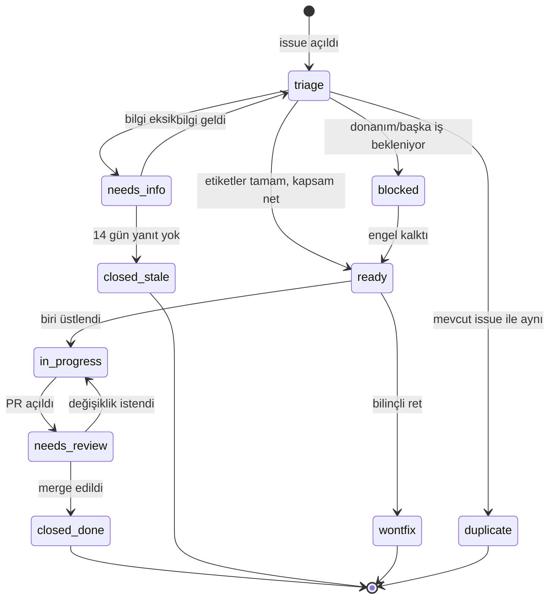

# Issue ve PR Etiket Taksonomisi

**Araç durumu (doğrulandı):** `gh 2.102.0` kurulu. Uzak depo yok, dolayısıyla
etiketler henüz yüklenemez. Bu rapor şemayı ve yükleme yöntemini tanımlar.

GitHub her yeni depoya 20 kadar varsayılan etiket verir (`bug`, `documentation`,
`enhancement`, `good first issue`, ...). Bu liste hem yetersiz hem fazla:
hiyerarşi yok, ama kullanılmayacak etiketler var. Karar: **varsayılanların
tamamı silinir**, aşağıdaki şema sıfırdan yüklenir.

---

## 1. Şema: dört eksen + topluluk etiketleri

Etiketler dört bağımsız eksende tanımlanır. Bir issue her eksenden **en fazla
bir** etiket alır.

```text
type/*       → işin doğası
component/*  → kodun neresi
priority/*   → aciliyet
status/*     → akıştaki konum
(topluluk)   → katkı biçimi
```

Bu ayrımın faydası filtreleme: `label:component/telemetry,priority/p1-high`
sorgusu "telemetri bileşenindeki acil işler" sonucunu verir. Tek düz bir etiket
listesiyle bu sorgu yazılamaz.

### 1.1 `type/*` — işin doğası

| Etiket | Renk | Ne zaman |
| --- | --- | --- |
| `type/bug` | `#d73a4a` | Beklenmeyen yanlış davranış |
| `type/feature` | `#0075ca` | Yeni yetenek |
| `type/refactor` | `#c5def5` | Davranış aynı, yapı değişiyor |
| `type/chore` | `#fef2c0` | Bakım, bağımlılık, temizlik |
| `type/docs` | `#0075ca` (açık) | Doküman |
| `type/test` | `#bfd4f2` | Test ekleme/düzeltme |
| `type/ci` | `#e4e669` | Workflow, kalite kapısı |
| `type/research` | `#7057ff` | Akademik deney, algoritma önerisi |
| `type/performance` | `#fbca04` | Hız/bellek iyileştirmesi |
| `type/security` | `#e11d48` | Güvenlik açığı (public değilse `SECURITY.md`'ye) |
| `type/question` | `#d876e3` | Kullanım sorusu |

`type/research` bu depoya özgü. Endüstriyel şemalarda yok ama burada
`00_durum_analizi/02_teknik_borc_ve_hatalar.md` dışındaki işlerin büyük kısmı
araştırma niteliğinde: NRC mimarisi seçimi, ablation tasarımı, yer gerçeği
senkronizasyonu. Bunları `type/feature` altında eritmek, akademik tartışmayı
kaybettirir.

### 1.2 `component/*` — kodun neresi

`01_dizin_yapisi/01_hedef_monorepo.md` içindeki modül ağacıyla birebir eşleşir:

| Etiket | Renk | Kapsadığı yollar |
| --- | --- | --- |
| `component/vision` | `#0e8a16` | `detector.py`, `geometry.py` |
| `component/calibration` | `#1d76db` | `calibration.py` |
| `component/tracking` | `#5319e7` | `tracking.py`, `filters/` |
| `component/telemetry` | `#fbca04` | `telemetry/*`, `listen.py` |
| `component/firmware` | `#d93f0b` | `firmware/**`, `esp32.c` |
| `component/nrc` | `#7057ff` | `nrc/**` (`PLANLANIYOR`) |
| `component/ci-cd` | `#e4e669` | `.github/**`, `pyproject.toml`, `.pre-commit-config.yaml` |
| `component/docs` | `#0075ca` | `docs/**`, `README.md` |
| `component/packaging` | `#bfdadc` | `pyproject.toml`, `uv.lock`, build |
| `component/data` | `#c2e0c6` | veri setleri, `fixtures/`, LFS |

`component/*` ile Conventional Commits scope'u aynı adları kullanır
(`02_kod_kalitesi/03_pre_commit.md` bölüm 4). Bu eşleşme sayesinde bir commit'in
scope'u ile onu kapatan issue'nun bileşen etiketi otomatik karşılaştırılabilir.

### 1.3 `priority/*` — aciliyet

| Etiket | Renk | Tanım | Tepki süresi |
| --- | --- | --- | --- |
| `priority/p0-critical` | `#b60205` | Sonuç üretmiyor / veri kaybı / güvenlik | aynı gün |
| `priority/p1-high` | `#d93f0b` | Makale bulgusunu veya CI'ı blokluyor | 1 hafta |
| `priority/p2-medium` | `#fbca04` | Kalite borcu, iş akışını yavaşlatıyor | 1 ay |
| `priority/p3-low` | `#c5def5` | İyileştirme, kozmetik | backlog |

`00_durum_analizi/02_teknik_borc_ve_hatalar.md` bölüm C'deki issue eşlemesi bu
şemayı kullanıyor. Somut örnekler:

- `A1` (atanmamış `track_id`) → `p1-high`: gerçek hata maskeleniyor, ama sistem
  çökmüyor. `p0` değil çünkü yalnızca ilk tespitte hata oluşursa tetiklenir.
- `B6` (`.pio` depoya girer) → `p1-high`: ilk `git add .` depo tarihini kalıcı
  olarak 23 MB şişirir. Geri almak `filter-repo` gerektirir.
- `B7` (`print` yerine `logging`) → `p3-low`: davranışı bozmuyor.

### 1.4 `status/*` — akıştaki konum

| Etiket | Renk | Anlamı |
| --- | --- | --- |
| `status/triage` | `#ededed` | Yeni açıldı, sınıflandırılmadı |
| `status/needs-info` | `#d4c5f9` | Bildirenden bilgi bekleniyor |
| `status/blocked` | `#b60205` | Başka bir işe/donanıma bağımlı |
| `status/in-progress` | `#0e8a16` | Üzerinde çalışılıyor |
| `status/needs-review` | `#fbca04` | PR açık, inceleme bekliyor |
| `status/wontfix` | `#ffffff` | Bilinçli olarak yapılmayacak |
| `status/duplicate` | `#cfd3d7` | Başka issue ile aynı |

GitHub'ın kendi "open/closed" durumu varken `status/*` gereksiz görünebilir.
Fark şu: GitHub closed/open ikili, ama `blocked` ile `in-progress` ikisi de
"open". `status/blocked` özellikle bu projede değerli, çünkü donanım
bağımlılığı var — `04_test_mimarisi/02_mock_kamera_seri_port.md` bölüm 6'daki
fixture üretimi fiziksel cihaza bağlı. Bu işler "yapılmıyor" değil,
"yapılamıyor" ve ayrım görünür olmalı.

### 1.5 Topluluk etiketleri

| Etiket | Renk | Not |
| --- | --- | --- |
| `good first issue` | `#7057ff` | GitHub'ın kendi "Contribute" panelinde görünür, adı **değiştirilemez** |
| `help wanted` | `#008672` | aynı |
| `academic-discussion` | `#7057ff` | bu depoya özgü; makale içeriği tartışması |
| `hardware-required` | `#d93f0b` | fiziksel cihaz olmadan çözülemez |
| `dependencies` | `#0366d6` | Dependabot otomatik ekler |

`good first issue` ve `help wanted` adları GitHub tarafından tanınır ve
`github.com/<owner>/<repo>/contribute` sayfasında listelenir. Yeniden
adlandırılırsa bu görünürlük kaybolur — bu yüzden bu ikisi şemanın dışında
tutuldu.

`hardware-required` bu depoya özgü ve önemli: bir katkıcı uzaktan bu issue'ları
çözemez. Etiketlenmezse biri işe başlar, donanım olmadığını fark edince iş yarım
kalır.

---

## 2. Etiketleri yükleme

### 2.1 Tanım dosyası

`scripts/labels.yml`:

```yaml
- name: "type/bug"
  color: "d73a4a"
  description: "Beklenmeyen yanlış davranış"
- name: "type/feature"
  color: "0075ca"
  description: "Yeni yetenek"
- name: "type/refactor"
  color: "c5def5"
  description: "Davranış değişmiyor, yapı değişiyor"
- name: "type/chore"
  color: "fef2c0"
  description: "Bakım ve temizlik"
- name: "type/docs"
  color: "bfd4f2"
  description: "Doküman"
- name: "type/test"
  color: "bfd4f2"
  description: "Test ekleme veya düzeltme"
- name: "type/ci"
  color: "e4e669"
  description: "CI/CD ve kalite kapıları"
- name: "type/research"
  color: "7057ff"
  description: "Akademik deney veya algoritma önerisi"
- name: "type/performance"
  color: "fbca04"
  description: "Hız veya bellek iyileştirmesi"
- name: "type/security"
  color: "e11d48"
  description: "Güvenlik açığı — önce SECURITY.md'ye bakın"
- name: "type/question"
  color: "d876e3"
  description: "Kullanım sorusu"

- name: "component/vision"
  color: "0e8a16"
  description: "detector.py, geometry.py"
- name: "component/calibration"
  color: "1d76db"
  description: "calibration.py, HFOV ve ölçek referansları"
- name: "component/tracking"
  color: "5319e7"
  description: "tracking.py, filters/kalman.py"
- name: "component/telemetry"
  color: "fbca04"
  description: "telemetry/*, seri port, ESP32 veri akışı"
- name: "component/firmware"
  color: "d93f0b"
  description: "firmware/**, PlatformIO"
- name: "component/nrc"
  color: "7057ff"
  description: "nrc/** — Nöral Artık Kalibratör (planlanıyor)"
- name: "component/ci-cd"
  color: "e4e669"
  description: ".github/**, pyproject.toml, pre-commit"
- name: "component/docs"
  color: "0075ca"
  description: "docs/**, README.md"
- name: "component/packaging"
  color: "bfdadc"
  description: "paketleme, bağımlılık çözümleme, uv.lock"
- name: "component/data"
  color: "c2e0c6"
  description: "veri setleri, test fixtures, LFS"

- name: "priority/p0-critical"
  color: "b60205"
  description: "Sistem sonuç üretmiyor veya veri kaybı var"
- name: "priority/p1-high"
  color: "d93f0b"
  description: "Makale bulgusunu veya CI hattını blokluyor"
- name: "priority/p2-medium"
  color: "fbca04"
  description: "Kalite borcu, iş akışını yavaşlatıyor"
- name: "priority/p3-low"
  color: "c5def5"
  description: "İyileştirme, kozmetik"

- name: "status/triage"
  color: "ededed"
  description: "Yeni açıldı, sınıflandırılmadı"
- name: "status/needs-info"
  color: "d4c5f9"
  description: "Bildirenden ek bilgi bekleniyor"
- name: "status/blocked"
  color: "b60205"
  description: "Başka bir işe veya donanıma bağımlı"
- name: "status/in-progress"
  color: "0e8a16"
  description: "Üzerinde çalışılıyor"
- name: "status/needs-review"
  color: "fbca04"
  description: "PR açık, inceleme bekliyor"
- name: "status/wontfix"
  color: "ffffff"
  description: "Bilinçli olarak yapılmayacak"
- name: "status/duplicate"
  color: "cfd3d7"
  description: "Başka bir issue ile aynı"

- name: "good first issue"
  color: "7057ff"
  description: "Yeni katkıcılar için uygun"
- name: "help wanted"
  color: "008672"
  description: "Ek katkı aranıyor"
- name: "academic-discussion"
  color: "7057ff"
  description: "Makale içeriği ve metodoloji tartışması"
- name: "hardware-required"
  color: "d93f0b"
  description: "Fiziksel ESP32 veya kamera olmadan çözülemez"
- name: "dependencies"
  color: "0366d6"
  description: "Bağımlılık güncellemesi (Dependabot)"
```

### 2.2 Yükleme betiği

`scripts/sync_labels.py`:

```python
"""scripts/labels.yml içindeki etiketleri uzak depoya uygular.

Kullanım:
    uv run python scripts/sync_labels.py --repo OWNER/REPO
    uv run python scripts/sync_labels.py --repo OWNER/REPO --dry-run
"""

from __future__ import annotations

import argparse
import json
import subprocess
import sys
from pathlib import Path

import yaml

REPO_ROOT = Path(__file__).resolve().parent.parent
LABELS_FILE = REPO_ROOT / "scripts" / "labels.yml"


def gh(args: list[str]) -> str:
    proc = subprocess.run(
        ["gh", *args], capture_output=True, text=True, check=False
    )
    if proc.returncode != 0:
        msg = f"gh {' '.join(args)} başarısız: {proc.stderr.strip()}"
        raise RuntimeError(msg)
    return proc.stdout


def existing_labels(repo: str) -> set[str]:
    out = gh(["label", "list", "--repo", repo, "--limit", "300", "--json", "name"])
    return {row["name"] for row in json.loads(out)}


def main() -> int:
    parser = argparse.ArgumentParser(description=__doc__)
    parser.add_argument("--repo", required=True, help="OWNER/REPO")
    parser.add_argument("--dry-run", action="store_true")
    parser.add_argument(
        "--prune", action="store_true",
        help="labels.yml içinde olmayan etiketleri sil (good first issue / help wanted hariç)",
    )
    args = parser.parse_args()

    wanted: list[dict[str, str]] = yaml.safe_load(LABELS_FILE.read_text())
    wanted_names = {item["name"] for item in wanted}
    current = existing_labels(args.repo)

    protected = {"good first issue", "help wanted"}

    if args.prune:
        for stale in sorted(current - wanted_names - protected):
            print(f"SILINECEK: {stale}")
            if not args.dry_run:
                gh(["label", "delete", stale, "--repo", args.repo, "--yes"])

    for item in wanted:
        action = "GUNCELLE" if item["name"] in current else "OLUSTUR"
        print(f"{action}: {item['name']} #{item['color']}")
        if args.dry_run:
            continue
        verb = "edit" if item["name"] in current else "create"
        gh([
            "label", verb, item["name"], "--repo", args.repo,
            "--color", item["color"], "--description", item["description"],
        ])

    print(f"\nToplam {len(wanted)} etiket tanımlı.")
    return 0


if __name__ == "__main__":
    sys.exit(main())
```

Çalıştırma:

```bash
uv run python scripts/sync_labels.py --repo OWNER/REPO --dry-run   # önizleme
uv run python scripts/sync_labels.py --repo OWNER/REPO --prune      # uygula + eskiyi sil
```

`--dry-run` olmadan çalıştırmak **uzak depoyu değiştirir**. Bu,
`.qwen/QWEN.md` güvenlik sınırları içinde "explicit confirmation required"
kategorisindedir: betik ilk kez çalıştırılırken önce `--dry-run` çıktısı
incelenmeli.

`--prune` bayrağı varsayılan değil. GitHub'ın 20 varsayılan etiketini silmek
geri alınamaz bir işlemdir (atanmış issue'lardaki etiketler düşer). Bilinçli
olarak verilmeli.

### 2.3 Doğrulama

```bash
gh label list --repo OWNER/REPO --limit 300
gh label list --repo OWNER/REPO --json name,color --jq 'length'
# beklenen: 38
```

---

## 3. Otomatik etiketleme: `.github/labeler.yml`

PR açıldığında değişen dosya yollarına göre etiket atanır.

`.github/labeler.yml`:

```yaml
component/vision:
  - changed-files:
      - any-glob-to-any-file:
          - "src/vehicle_speed/geometry.py"
          - "src/vehicle_speed/detector.py"

component/calibration:
  - changed-files:
      - any-glob-to-any-file: ["src/vehicle_speed/calibration.py"]

component/tracking:
  - changed-files:
      - any-glob-to-any-file:
          - "src/vehicle_speed/tracking.py"
          - "src/vehicle_speed/filters/**"

component/telemetry:
  - changed-files:
      - any-glob-to-any-file: ["src/vehicle_speed/telemetry/**"]

component/firmware:
  - changed-files:
      - any-glob-to-any-file: ["firmware/**"]

component/nrc:
  - changed-files:
      - any-glob-to-any-file: ["src/vehicle_speed/nrc/**"]

component/ci-cd:
  - changed-files:
      - any-glob-to-any-file:
          - ".github/**"
          - ".pre-commit-config.yaml"
          - "pyproject.toml"

component/docs:
  - changed-files:
      - any-glob-to-any-file:
          - "docs/**"
          - "README.md"
          - "CONTRIBUTING.md"

component/data:
  - changed-files:
      - any-glob-to-any-file: ["tests/fixtures/**"]

type/test:
  - changed-files:
      - any-glob-to-any-file: ["tests/**"]
```

`.github/workflows/labeler.yml`:

```yaml
name: Labeler

on:
  pull_request_target:
    types: [opened, synchronize, reopened]

permissions:
  contents: read
  pull-requests: write

jobs:
  label:
    runs-on: ubuntu-latest
    timeout-minutes: 5
    steps:
      - uses: actions/labeler@8558fd74291d67161a8a78ce36a881fa63b766a9  # v5.0.0
        with:
          repo-token: "${{ secrets.GITHUB_TOKEN }}"
          configuration-path: .github/labeler.yml
          sync-labels: true
```

### `pull_request_target` uyarısı

`labeler` action'ı `pull_request_target` kullanmak zorunda, çünkü fork'tan gelen
PR'da `pull_request` olayında `GITHUB_TOKEN`'ın yazma yetkisi yok. Ama
`pull_request_target` **base branch'in kodunu** çalıştırır, PR branch'ininkini
değil. Bu yüzden:

- `actions/checkout` **çağrılmamalı** (PR kodunu çekmek güvenlik riski yaratır)
- `configuration-path` base branch'ten okunur, bu istenen davranış

Bu ayrım atlanırsa, fork'tan gelen bir PR kendi `labeler.yml` dosyasını
çalıştırabilir. Yukarıdaki workflow'da `checkout` adımı yok — bu bilinçli.

### `sync-labels: true`

PR'dan bir dosya geri alınırsa (ör. `firmware/` değişikliği iptal edilirse),
`component/firmware` etiketi de kaldırılır. `false` olsaydı etiketler birikir ve
PR içeriğini yansıtmaz hale gelirdi.

---

## 4. Issue triage akışı



Yeni açılan her issue otomatik `status/triage` alır. Bu, `config.yml` ile
yapılamaz (Issue Forms etiket önerebilir ama zorunlu kılamaz); bir workflow
gerekir:

```yaml
name: Issue triage

on:
  issues:
    types: [opened]

permissions:
  issues: write

jobs:
  triage:
    runs-on: ubuntu-latest
    timeout-minutes: 5
    steps:
      - name: Add triage label
        run: gh issue edit "$NUMBER" --add-label "status/triage" --repo "$REPO"
        env:
          GH_TOKEN: ${{ secrets.GITHUB_TOKEN }}
          REPO: ${{ github.repository }}
          NUMBER: ${{ github.event.issue.number }}
```

`status/triage` etiketi olan issue sayısı, bakım yükünün doğrudan ölçüsüdür:

```bash
gh issue list --repo OWNER/REPO --label status/triage --json number,title --jq 'length'
```

Bu sayı 20'yi geçerse triage birikmiş demektir.

---

## 5. Etiket kullanımı kuralları

`CONTRIBUTING.md`'ye yazılacak maddeler:

1. **Yeni etiket uydurma.** Şemada olmayan bir etiket gerekiyorsa, önce issue
   açılıp tartışılır. Serbest etiket eklemek hiyerarşiyi bozar.
2. **Her eksenden en fazla bir.** Bir issue hem `priority/p1-high` hem
   `priority/p2-medium` alamaz. Çelişki varsa yüksek olan seçilir ve gerekçe
   yazılır.
3. **`type/bug` + kanıt zorunlu.** `bug_report.yml` formu zaten zorunlu alanlar
   içeriyor (`02_issue_pr_sablonlari.md`). Kanıtsız hata bildirimi
   `status/needs-info` alır.
4. **`hardware-required` erken konulur.** Donanım gerektiren iş en başta
   işaretlenmezse uzaktan katkı yapmaya çalışan biri boşa emek verir.
5. **`status/wontfix` gerekçesiz kapatılmaz.** Kapatma yorumunda neden yazılır.
   Bu, aynı isteğin üç ay sonra tekrar açılmasını önler.

---

## 6. Sorgu örnekleri

```bash
# telemetri bileşenindeki acil işler
gh issue list --label "component/telemetry,priority/p1-high"

# yeni katkıcıya uygun, donanım gerektirmeyen işler
gh issue list --label "good first issue" --search "-label:hardware-required"

# triage bekleyenler
gh issue list --label "status/triage" --json number,title,createdAt

# makale tartışmaları
gh issue list --label "academic-discussion,type/research"

# CI'ı bozan işler
gh issue list --label "component/ci-cd,status/blocked"

# bu hafta kapananlar
gh issue list --state closed --search "closed:>2026-10-06"
```

GitHub arayüzünde aynı sorgular:

```text
is:issue is:open label:"component/telemetry" label:"priority/p1-high"
is:issue is:open label:"good first issue" -label:"hardware-required"
is:pr is:open label:"status/needs-review" review:none
```

Son sorgu incelemesi bekleyen PR'ları verir — `04_branch_koruma_inceleme.md`
içindeki inceleme sürecinin giriş noktası.

---

## 7. Açık noktalar

1. **`status/*` ile GitHub Projects entegrasyonu.** `status/in-progress` gibi
   etiketler, bir proje panosu kurulursa panodaki sütunlarla çakışır. İki kaynak
   aynı durumu tutarsa ayrışırlar. Karar: pano kurulursa `status/*` etiketleri
   kaldırılıp yalnızca pano kullanılır. Şimdilik pano yok.
2. **`type/security` public issue olarak açılmamalı.** Gerçek bir açık için
   GitHub Private Vulnerability Reporting kullanılmalı
   (`05_yonetisim/03_contributing_ortam_kurulumu.md` değil, `SECURITY.md`).
   Etiketin varlığı, düşük riskli güvenlik iyileştirmeleri içindir.
3. **Etiket sayısı.** 38 etiket, tek kişilik bir proje için çok görünebilir.
   Gerekçe: makale kapsamında bileşen bazında iş takibi gerekiyor ve
   `gh issue list --label component/firmware` sorgusu, `CHANGELOG.md`
   üretiminde scope ile eşleşiyor. Maliyet düşük (bir kez yükleniyor), fayda
   sürekli.
