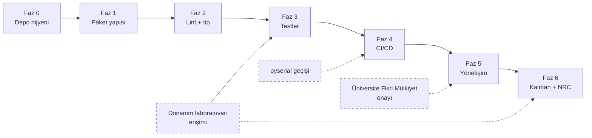

# Adım Adım Uygulama Planı

Bu rapor, `docs/infrastructure/` altındaki diğer tüm raporların **icra
sırasıdır**. Her fazın sonunda bir doğrulama komutu var; komut geçmeden
sonraki faza geçilmez.

**Önemli:** Bu bir plandır, henüz uygulanmadı. Diskte `pyproject.toml`,
`.github/`, `tests/` yok. Aşağıdaki tüm kutular işaretsiz.

Faz sırası bağımlılıklara göre kuruldu. Sırayı değiştirmenin somut sonuçları
her fazın başında "Neden burada?" satırında yazılı.

---

## Faz 0 — Depo hijyeni ve sürüm kontrolü

**Neden ilk:** `.gitignore` yazılmadan `git add .` yapılırsa 273 MB'lık
`yolov8x.onnx` index'e girer ve push reddedilir. Geçmişten silmek
`git filter-repo` gerektirir. Bu geri alınamaz sınıf bir hata, o yüzden her
şeyden önce.

Dayanak: `06_veri_model_yonetimi/01_gitignore_lfs_veri_izlenebilirligi.md`

- [ ] **0.1** Mevcut `.git`'i koru: `mv .git .git.broken`
- [ ] **0.2** `.git.broken/config` ve `packed-refs` içeriğini incele; uzak depo
      adresi varsa not al
- [ ] **0.3** `GIT_INDEX_FILE=.git.broken/index git ls-files` ile daha önce
      izlenen dosyaları listele
- [ ] **0.4** `find .git.broken/objects -type f | wc -l` → kurtarılabilir nesne
      var mı (0 ise geçmiş kayıp)
- [ ] **0.5** Kopya medya denetimi: `sha256sum fotograflar/top.mp4 fotograflar/top2.mp4`
- [ ] **0.6** `.gitignore` yaz (bölüm 2'deki tam metin)
- [ ] **0.7** `!docs/**/*.png` istisnalarını ekle
- [ ] **0.8** `.gitattributes` yaz (`text=auto eol=lf` + `binary` işaretleri)
- [ ] **0.9** `Yapay zeka/` → `archive/legacy_scripts/` taşı (silme yok)
- [ ] **0.10** `,*` yetim dosyasını incele, sonra `archive/`'a taşı
- [ ] **0.11** `esp32.c` sil (içerik `firmware/src/main.cpp` ile aynı, fark 10 satır yorum)
- [ ] **0.12** `git init -b main`
- [ ] **0.13** `git add --dry-run .` çıktısında 1 MB üstü dosya olmadığını doğrula
- [ ] **0.14** `git add . && git commit -m "chore: initialize repository with existing research code"`

**Doğrulama:**

```bash
git status --short | head                     # temiz olmalı
git count-objects -vH                          # size-pack < 20 MB
git ls-files | wc -l                           # beklenen: ~60-80 dosya
git ls-files -z | xargs -0 stat -c '%s %n' 2>/dev/null | sort -rn | head -5
# en büyük izlenen dosya < 5 MB olmalı
find .git/objects -type f | wc -l              # 0 OLMAMALI (bozuk depo belirtisi)
git log --oneline                              # 1 commit görünmeli
```

Bu faz bitmeden hiçbir sonraki faz anlamlı değil: `pre-commit` çalışmaz,
CI push edilemez, `gh` komutları depo bulamaz.

---

## Faz 1 — Paket yapısı ve bağımlılık manifesti

**Neden burada:** Lint ve test araçları import edilebilir bir paket gerektirir.
Kök dizindeki iki script ile `pytest` yazılamaz.

Dayanak: `01_dizin_yapisi/01_hedef_monorepo.md`, `02_teknik_borc_ve_hatalar.md` B2/B3

- [ ] **1.1** `src/vehicle_speed/` dizin ağacını oluştur
- [ ] **1.2** `pyproject.toml` yaz (PEP 621 + hatchling + bağımlılık grupları)
- [ ] **1.3** `uv python install 3.12` + `.python-version` dosyası
- [ ] **1.4** `uv sync --extra dev` → `uv.lock` üret
- [ ] **1.5** `uv.lock`'ı depoya commit et (tekrarlanabilirlik)
- [ ] **1.6** `[tool.uv.sources]` ile CPU-only torch indeksini ayarla
- [ ] **1.7** `torch`'un CUDA'sız geldiğini doğrula
- [ ] **1.8** `kadir.py` → `geometry.py` + `tracking.py` + `detector.py` + `visualization.py` + `cli.py` böl
- [ ] **1.9** `1_donem_kadir.py` → aynı modüllere birleştir (kopya `estimate_depth`/`compute_speed` tek kopya olur)
- [ ] **1.10** `listen.py` → `telemetry/serial_reader.py` (pyserial tabanlı, argparse ile port)
- [ ] **1.11** `telemetry/protocol.py` yaz (4 olay tipi, `parse_line`)
- [ ] **1.12** `telemetry/ground_truth.py` yaz (`steps_to_metres`, `ground_truth_speed`)
- [ ] **1.13** `config.py` yaz — gömülü sabitleri taşı (`hfov=85.0`, `initial_dist`, `BALL_WIDTH_CM`, ...)
- [ ] **1.14** `__init__.py` içine `__version__ = "0.1.0"` + `py.typed`
- [ ] **1.15** Eski `kadir.py`, `1_donem_kadir.py`, `listen.py` dosyalarını kaldır

**Doğrulama:**

```bash
uv run python -c "import vehicle_speed; print(vehicle_speed.__version__)"
# beklenen: 0.1.0

uv run python -c "from vehicle_speed.geometry import estimate_depth; print(estimate_depth(1200.0, 0.52, 100.0))"
# beklenen: 6.24

uv run python -c "import torch; print(torch.__version__, torch.version.cuda)"
# beklenen: 2.x.y+cpu None

# kopya kod kalmadığını doğrula
grep -rn "def estimate_depth" src/ | wc -l        # beklenen: 1
grep -rn "cv2.imshow" src/ | cut -d: -f1 | sort -u  # beklenen: yalnızca visualization.py
grep -rn "^from ultralytics\|^import ultralytics\|^import torch\|^from torch" src/
# beklenen: ÇIKTI YOK (hepsi fonksiyon gövdesinde olmalı)

# birim sınırları
uv run python -c "
import ast, pathlib
for p in ('geometry','tracking','calibration'):
    tree = ast.parse(pathlib.Path(f'src/vehicle_speed/{p}.py').read_text())
    bad = [a.name.split('.')[0] for n in ast.walk(tree) if isinstance(n,(ast.Import,ast.ImportFrom))
           for a in (n.names if isinstance(n,ast.Import) else [type('x',(),{'name':n.module})()])
           if a.name in ('cv2','torch','ultralytics','serial')]
    print(f'{p}.py:', 'TEMIZ' if not bad else f'IHLAL {bad}')
"
```

---

## Faz 2 — Kod kalitesi kapıları

**Neden burada:** Paket yapısı kuruldu, artık lint anlamlı. Faz 1'den önce
çalıştırılsa 141 hata kök dizindeki eski dosyalarda raporlanır ve iki kez iş
yapılır.

Dayanak: `02_kod_kalitesi/01_ruff_linter_formatter.md`, `02_mypy_strict.md`, `03_pre_commit.md`

- [ ] **2.1** `pyproject.toml`'a `[tool.ruff]` bölümünü ekle (doğrulanmış kural seti: `RUF` değil, `TC` kullan)
- [ ] **2.2** `ruff check --select W293,W291,I001 --fix` + `ruff format` → **ayrı commit** (`style:`)
- [ ] **2.3** `ruff check --select UP --fix` → **ayrı commit** (`refactor:`)
- [ ] **2.4** Kalan `E501` satırlarını çöz
- [ ] **2.5** `LEFT_HEADLIGHT_IDX`/`RIGHT_HEADLIGHT_IDX` modül seviyesine taşı (`N806` kapanır)
- [ ] **2.6** `ruff check .` → sıfır hata
- [ ] **2.7** `ruff format --check .` → sıfır fark
- [ ] **2.8** `uv pip install mypy` + `[tool.mypy]` yapılandırması
- [ ] **2.9** `enable_error_code = ["possibly-undefined", ...]` ekle
- [ ] **2.10** Kademeli mypy: `geometry.py` → `tracking.py`/`calibration.py` → `telemetry/` → `detector.py` → `cli.py`
- [ ] **2.11** `mypy` → sıfır hata
- [ ] **2.12** `.pre-commit-config.yaml` yaz (ruff/mypy rev'leri `pyproject.toml` ile aynı)
- [ ] **2.13** `pre-commit install` (üç hook tipi)
- [ ] **2.14** `commitizen` yapılandırması + `CHANGELOG.md` başlat
- [ ] **2.15** `.clang-format` yaz + `firmware/src/main.cpp` biçimlendir → **ayrı commit**

**Doğrulama:**

```bash
uv run ruff check . ; echo "ruff exit: $?"          # beklenen: 0
uv run ruff format --check . ; echo "format exit: $?"  # beklenen: 0
uv run mypy ; echo "mypy exit: $?"                  # beklenen: 0
uv run pre-commit run --all-files                   # tüm kancalar yeşil
ls .git/hooks/ | grep -E 'pre-commit|commit-msg|pre-push'   # üçü de var
clang-format --dry-run --Werror firmware/src/main.cpp ; echo "clang exit: $?"  # 0

# sürüm eşleşmesi
grep -o 'ruff==[0-9.]*' pyproject.toml
grep -A1 'ruff-pre-commit' .pre-commit-config.yaml | grep rev
```

---

## Faz 3 — Test altyapısı

**Neden burada:** Lint kapıları açık, kod paket halinde. Test yazılabilir
durumda. CI'dan **önce** gelmesinin sebebi: test yokken CI açılırsa ilk koşu
kırmızı olur ve "CI bozuk" izlenimi verir.

Dayanak: `04_test_mimarisi/01_test_piramidi.md`, `02_mock_kamera_seri_port.md`

- [ ] **3.1** `uv pip install pytest pytest-cov pytest-mock` + `[tool.pytest.ini_options]`
- [ ] **3.2** `tests/` dizin ağacı (`unit/`, `integration/`, `e2e/`, `hardware/`, `fixtures/`)
- [ ] **3.3** `tests/conftest.py`: `--run-hardware` seçeneği + otomatik atlama
- [ ] **3.4** `test_geometry.py`: pinhole formülü, ters orantı, `ValueError` sınırları
- [ ] **3.5** `test_geometry.py`: **Z² hata yayılımı testi** (makale çekirdeği)
- [ ] **3.6** `test_calibration.py`: dinamik kalibrasyon round-trip, HFOV türetme
- [ ] **3.7** `test_tracking.py`: sabit hız yakınsaması, `MATH_INTERVAL` ölçeklemesi, `prune` dönüş değeri
- [ ] **3.8** `test_telemetry_protocol.py`: 4 olay tipi ayrıştırma, bozuk/kısmi satırda `None`
- [ ] **3.9** `test_telemetry_protocol.py`: satır yeniden birleştirme (256 bayt bölünmesi)
- [ ] **3.10** `tests/fixtures/telemetry_sample.jsonl` üret — **donanım gerekli**, sentetik ile başlanabilir
- [ ] **3.11** `test_firmware_contract.py`: `.h` ↔ `protocol.py` sabit eşitliği
- [ ] **3.12** `test_pipeline_offline.py`: mock dedektör + gerçek geometry/tracking
- [ ] **3.13** `[tool.coverage]` yapılandırması + `fail_under = 85`
- [ ] **3.14** `A1` hatasını düzelt (atanmamış `track_id`) + regresyon testi
- [ ] **3.15** `A2` hatasını düzelt (sessiz kalibrasyon başarısızlığı) + regresyon testi
- [ ] **3.16** `A3` hatasını düzelt (`listen.py` sabit yol)

**Doğrulama:**

```bash
uv run pytest tests/unit -v                          # tümü geçmeli
uv run pytest tests/ -q --cov=src --cov-report=term-missing
# beklenen: TOTAL ... >= 85%

uv run pytest --collect-only -q | grep -c hardware   # beklenen: 0
uv run pytest --collect-only -q | wc -l              # beklenen: >= 40 test

# A1 regresyonunun gerçekten eski hatayı yakaladığını kanıtla:
git stash && uv run pytest tests/unit/test_detector.py -q ; git stash pop
# beklenen: stash'li (eski) kodda test DÜŞMELİ
```

Son doğrulama kritik: yeni yazılan bir test, eski kodla da geçiyorsa hiçbir
şeyi korumuyor demektir.

---

## Faz 4 — CI/CD

**Neden burada:** Yerelde `ruff`, `mypy`, `pytest` yeşil. CI bunu uzakta
tekrarlar. Ters sırada yapılırsa CI'ı yeşile getirmek için körlemesine
deneme-yanılma gerekir.

Dayanak: `03_ci_cd/01_pipeline_mimarisi.md`, `02_ci_workflow_adimlari.md`, `03_test_matrisi_cache.md`

- [ ] **4.1** Uzak depo oluştur (`gh repo create`, **private** — lisans/sahiplik soruları netleşmeden public yapma)
- [ ] **4.2** `git push -u origin main`
- [ ] **4.3** `.github/workflows/ci.yml` yaz — **başlangıçta yalnızca `ubuntu-latest` matrisi**
- [ ] **4.4** `check-jsonschema --check-github-workflows` ile yerelde doğrula
- [ ] **4.5** Push, ilk koşuyu izle (`gh run watch`)
- [ ] **4.6** Önbellek isabetini doğrula (ikinci koşu belirgin şekilde hızlı olmalı)
- [ ] **4.7** `pyserial` geçişi tamamlandıktan sonra `windows-latest` ekle
- [ ] **4.8** `firmware.yml` yaz (PlatformIO + cppcheck + clang-format)
- [ ] **4.9** `labeler.yml` + `.github/labeler.yml`
- [ ] **4.10** `codeql.yml` + secret scanning etkinleştir
- [ ] **4.11** `summary` job'ı + branch protection'a "All checks" ekle
- [ ] **4.12** `release.yml` + `v0.1.0` tag'i
- [ ] **4.13** `dependabot.yml`
- [ ] **4.14** Dependency compatibility probe workflow'u (haftalık Python sürüm taraması)

**Doğrulama:**

```bash
gh run list --limit 10                                  # tümü completed
gh run list --workflow ci.yml --json conclusion --jq '.[].conclusion' | sort -u
# beklenen: yalnızca "success"

gh api repos/OWNER/REPO/actions/runs/$(gh run list --limit 1 --json databaseId --jq '.[0].databaseId')/jobs \
  --jq '.jobs[] | "\(.name): \(.started_at) → \(.completed_at)"'

# önbellek çalışıyor mu
gh api repos/OWNER/REPO/actions/caches --jq '.total_count'

# ikinci koşu süresi ilk koşudan belirgin kısa mı
gh run list --workflow ci.yml --limit 3 --json databaseId,createdAt,updatedAt
```

---

## Faz 5 — Yönetişim

**Neden burada:** CI yeşil, depo çalışıyor. Artık dışarıdan katkıya açılabilir.
Daha erken yapılırsa şablonlar test edilemez (issue açıp denemek gerekir).

Dayanak: `05_yonetisim/*`

- [ ] **5.1** `LICENSE` (AGPL-3.0 tam metni, değiştirilmeden)
- [ ] **5.2** `CITATION.cff` — makale alanları boş bırakılır, `notes` ile belirtilir
- [ ] **5.3** `README.md` — durum tablosunda `PLANLANIYOR` satırları dürüstçe
- [ ] **5.4** `CONTRIBUTING.md`
- [ ] **5.5** `SECURITY.md` + Private Vulnerability Reporting etkinleştir
- [ ] **5.6** `CODE_OF_CONDUCT.md` (Contributor Covenant v2.1, indirildiği gibi)
- [ ] **5.7** `scripts/labels.yml` + `scripts/sync_labels.py`
- [ ] **5.8** `--dry-run` ile önizle, sonra etiketleri yükle (`--prune`)
- [ ] **5.9** `.github/ISSUE_TEMPLATE/` — `bug_report.yml`, `feature_request.yml`, `research_proposal.yml`, `config.yml`
- [ ] **5.10** `.github/PULL_REQUEST_TEMPLATE.md`
- [ ] **5.11** `CODEOWNERS`
- [ ] **5.12** `scripts/apply_branch_protection.sh --dry-run`, sonra uygula
- [ ] **5.13** Discussions etkinleştir (veya `config.yml`'deki bağlantıyı kaldır)
- [ ] **5.14** `02_teknik_borc_ve_hatalar.md` bölüm C'deki 13 issue'yu aç
- [ ] **5.15** Üniversite fikri mülkiyet sorusunu netleştir → sonra depoyu public yap

**Doğrulama:**

```bash
gh label list --json name --jq 'length'                  # beklenen: 38
gh issue list --limit 20 --json number,title,labels      # 13 issue açılmış
gh api repos/OWNER/REPO/branches/main/protection \
  --jq '{checks: .required_status_checks.contexts, admins: .enforce_admins.enabled}'
# beklenen: {"checks": ["All checks"], "admins": true}

# şablonlar web arayüzünde görünüyor mu (ELLE)
# https://github.com/OWNER/REPO/issues/new/choose
# üç şablon listelenmeli

# ölü bağlantı denetimi
grep -ohE '\]\([^)#]+\)' README.md CONTRIBUTING.md SECURITY.md | \
  sed 's/](//;s/)//' | grep -v '^http' | while read -r l; do
    [ -e "$l" ] || echo "ÖLÜ: $l"
  done
```

Şablon görünürlüğü `gh` ile denetlenemez — bu adım elle yapılmalı.

---

## Faz 6 — Araştırma bileşenleri (`PLANLANIYOR`)

**Neden son:** Altyapı hazır olmadan algoritma geliştirmek, ölçülemeyen sonuç
üretir. Kalman ve NRC eklendiğinde CI, test ve ablation altyapısı zaten yerinde
olmalı.

Dayanak: `Q2_MAKALE_STRATEJISI_VE_YAPAY_ZEKA_RAPORU.md`

- [ ] **6.1** `filters/kalman.py` — sabit hızlı model, `SpeedTracker.update` imzasını koru
- [ ] **6.2** `test_kalman.py` — gürültü sönümleme, yakınsama, kovaryans tekilleşme (`ε = 1e-6`)
- [ ] **6.3** Ablation altyapısı: `baseline` / `+kalman` / `+nrc` konfigürasyonları
- [ ] **6.4** `scripts/collect_dataset.py` — ESP32 log ↔ video kare eşleştirme
- [ ] **6.5** **Zaman senkronizasyonu çözümünü belirle** (`02_modul_sinirlari_veri_kontratlari.md` bölüm 5, madde 1)
- [ ] **6.6** `status` olayı aralığını ölç ve gerekirse firmware'de düşür (`04_test_mimarisi/02_mock_kamera_seri_port.md` bölüm 5)
- [ ] **6.7** Yer gerçeği veri setini topla (donanım laboratuvarı)
- [ ] **6.8** `tests/fixtures/telemetry_sample.jsonl` dosyasını gerçek kayıtla değiştir
- [ ] **6.9** `nrc/features.py` — 5 girdi çıkarımı (`v_raw`, `w_px`, `y_norm`, `AR`, `conf`)
- [ ] **6.10** `nrc/model.py` — `[5]→[32]→[16]→[8]→[1]`, artık-hata (`Δv`) çıktısı
- [ ] **6.11** `test_nrc_model.py` — tensör sözleşmesi `[B,5]→[B,1]`, NaN yok, CPU gecikmesi < 0.1 ms
- [ ] **6.12** `nrc/train.py` — `torch.load(..., weights_only=True)` zorunlu
- [ ] **6.13** Ablasyon çalışması: her girdinin tek tek katkısı
- [ ] **6.14** Wilcoxon signed-rank testi (`p < 0.001`)
- [ ] **6.15** SOTA kıyaslama tablosu (homografi, optik akış, saf pinhole, Kalman, NRC)
- [ ] **6.16** Eğitim veri seti ve kodunun tekrarlanabilirlik paketini hazırla (`05_lisans_citation.md` bölüm 5.2)
- [ ] **6.17** `v0.3.0` + Zenodo arşivi + `paper/*` tag'i

**Doğrulama:**

```bash
uv run pytest tests/ -q --cov=src                    # kapsam >= %85 korunuyor
uv run python -c "
import time, torch
from vehicle_speed.nrc.model import NeuralResidualCalibrator
m = NeuralResidualCalibrator()
print('parametre:', sum(p.numel() for p in m.parameters()))
x = torch.randn(1, 5)
t0 = time.perf_counter()
for _ in range(1000): m(x)
print(f'gecikme: {(time.perf_counter()-t0):.3f} ms / 1000 çıkarım')
out = m(x)
print('sekil:', tuple(out.shape), 'NaN:', bool(torch.isnan(out).any()))
"
# beklenen: parametre ~850, sekil (1,1), NaN False
```

---

## Fazlar arası bağımlılık grafiği



Kesikli kenarlar **dış bağımlılıklar**: kod yazarak çözülmeyen, fiziksel
erişim veya kurumsal onay gerektiren engeller.

- `HW` (donanım): Faz 3'ün 3.10 adımı ve Faz 6'nın tamamı için. Faz 3 sentetik
  fixture ile başlatılabilir, ama gerçek kayıt gelmeden telemetri testleri
  eksik kalır.
- `LEGAL`: Faz 5'in 5.15 adımı (depoyu public yapma) için. Faz 0-5 private
  depoda tamamlanabilir.
- `PYSERIAL`: Faz 4'ün 4.7 adımı (Windows matrisi) için. Faz 1'in 1.10 adımı
  bunu zaten kapsıyor; ok yalnızca sıralamayı hatırlatıyor.

---

## Sıra ihlalinin sonuçları

| Atlama | Sonuç |
| --- | --- |
| Faz 0 atlanır | 273 MB dosya index'e girer, push reddedilir, `filter-repo` gerekir |
| Faz 1 atlanır | `pytest` import edecek paket bulamaz, test yazılamaz |
| Faz 2 atlanır | CI ilk koşuda 141 lint hatasıyla kırmızı, güven kaybolur |
| Faz 3 atlanır | CI'da test adımı boş geçer, `%85` kapsam eşiği anlamsız |
| Faz 4 atlanır | Branch protection'a eklenecek check adı listede görünmez |
| Faz 5 atlanır | Dış katkı geldiğinde şablon/etiket yok, triage elle yapılır |
| Faz 6 önce yapılır | Kalman/NRC ölçülemeyen sonuç üretir, ablation altyapısı yok |

Faz 4 → Faz 5 sırası tersine çevrilebilir (yönetişim önce), ama branch
protection'a "All checks" eklemek için workflow'un en az bir kez çalışmış
olması gerekir (`04_branch_koruma_inceleme.md` bölüm 2.4). Bu yüzden önerilen
sıra korunmalı.
