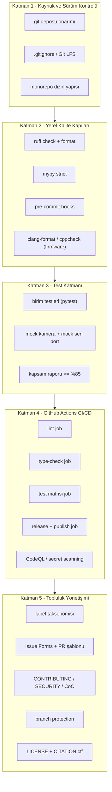

# Kurumsal Açık Kaynak Altyapı — Geliştirme Raporları Dizini

Bu dizin, **Görüntü İşleme ile Hız Tespiti** projesini kurumsal açık kaynak standardına
taşımak için gereken altyapının tamamını adım adım raporlar: CI test hattı, kod kalitesi
kuralları (Ruff/Mypy), Issue ve PR şablonları, etiket taksonomisi, açık kaynak depo
kuralları, test mimarisi ve veri/model yönetimi.

Referans alınan olgunluk seviyesi: `qwen-code` deposu (modüler monorepo, sıkı linter
kapıları, çoklu ortam CI matrisi, hiyerarşik etiket sistemi, Issue Forms).

Raporların tamamı **2026-10-13 tarihinde diskte doğrulanmış kanıtlara** dayanır.
Uydurma tamamlanmışlık beyanı içermez; her iddia bir dosya yolu, komut çıktısı veya
ölçümle desteklenir.

---

## Durum göstergeleri

Her raporda bileşenler aşağıdaki üç etiketten biriyle işaretlenir:

| Etiket | Anlamı |
| --- | --- |
| `VAR` | Dosya/kod diskte doğrulandı, çalışıyor |
| `YOK` | Diskte yok, bu raporda kurulması anlatılıyor |
| `PLANLANIYOR` | Kod tabanında henüz mevcut değil, makale hedefi için tasarlanıyor |

Örnek: `kadir.py` içindeki pinhole derinlik hesabı `VAR`; Kalman filtresi ve
5 girdili Nöral Artık Kalibratör (NRC) `PLANLANIYOR`. İkisi de bugün diskte yok.

---

## Okuma sırası

```text
docs/infrastructure/
├── README.md                          ← buradasınız (indeks + genel bakış)
│
├── 00_durum_analizi/
│   ├── 01_mevcut_envanter.md          ← diskte ne var: dosya dosya kanıtlı envanter
│   └── 02_teknik_borc_ve_hatalar.md   ← gerçek kod hataları ve altyapı borçları
│
├── 01_dizin_yapisi/
│   ├── 01_hedef_monorepo.md           ← hedef ağaç + mevcut→hedef taşıma eşlemesi
│   └── 02_modul_sinirlari_veri_kontratlari.md
│
├── 02_kod_kalitesi/
│   ├── 01_ruff_linter_formatter.md    ← doğrulanmış çalışan kural seti (141 hata analizi)
│   ├── 02_mypy_strict.md
│   ├── 03_pre_commit.md
│   └── 04_firmware_c_statik_analiz.md ← ESP32/PlatformIO tarafı ayrı kalite kapısı
│
├── 03_ci_cd/
│   ├── 01_pipeline_mimarisi.md        ← mermaid job grafiği
│   ├── 02_ci_workflow_adimlari.md     ← satır satır ci.yml açıklaması
│   ├── 03_test_matrisi_cache.md       ← OS × Python matrisi, uv cache, CPU-only torch
│   └── 04_release_versiyonlama.md     ← semver, tag, GitHub Release, CITATION
│
├── 04_test_mimarisi/
│   ├── 01_test_piramidi.md            ← birim/entegrasyon/donanım katmanları
│   └── 02_mock_kamera_seri_port.md    ← CI'da donanım olmadan test etme katmanı
│
├── 05_yonetisim/
│   ├── 01_label_taksonomisi.md        ← type/component/priority/status hiyerarşisi
│   ├── 02_issue_pr_sablonlari.md      ← GitHub Issue Forms + PR şablonu
│   ├── 03_contributing_ortam_kurulumu.md
│   ├── 04_branch_koruma_inceleme.md
│   └── 05_lisans_citation.md
│
├── 06_veri_model_yonetimi/
│   └── 01_gitignore_lfs_veri_izlenebilirligi.md  ← 1.3 GB'lık ikili dosya politikası
│
└── 07_uygulama_yol_haritasi/
    ├── 01_adim_adim_uygulama.md       ← checkbox'lı, sıralı, doğrulama komutlu icra planı
    └── 02_kabul_kriterleri.md         ← her fazın "bitti" tanımı
```

Önerilen sıra: `00` → `01` → `06` → `02` → `04` → `03` → `05` → `07`.
`06`'nın öne alınmasının sebebi, bozuk `.git` dizini onarılıp ilk commit atılmadan
önce 1.3 GB'lık ikili dosyaların depo dışına alınması zorunluluğudur. Aksi halde
depo daha ilk push'ta kullanılamaz hale gelir.

---

## Altyapı katmanları



Katmanlar sıralı bağımlılık taşır. Katman 1 tamamlanmadan Katman 4'teki CI hattı
çalıştırılamaz, çünkü GitHub Actions bir uzak depo ve en az bir push gerektirir.

---

## Kanıt tabanı

Bu dizindeki raporlar aşağıdaki komutların gerçek çıktısına dayanır. Yeniden
çalıştırıldığında aynı sonuçlar alınmalıdır (sürüm farkları hariç).

| Komut | Amaç | Elde edilen bulgu |
| --- | --- | --- |
| `git status` | depo durumu | `exit 128`, "Bir git deposu değil" |
| `ls -la .git/` | depo bütünlüğü | `objects/` boş, `refs/` yok |
| `ruff check --statistics kadir.py 1_donem_kadir.py listen.py` | lint taban çizgisi | 141 hata, 115'i otomatik düzeltilebilir |
| `ruff check .` (plandaki config) | yapılandırma geçerliliği | `Unknown rule selector 'RUFF'` → config çöküyor |
| `find . -type f -size +1M` | ikili dosya envanteri | en büyüğü 273 MB (`yolov8x.onnx`) |
| `du -sh` | dizin hacmi | `Yapay zeka` 511 MB, `fotograflar` 303 MB |
| `diff esp32.c firmware/src/main.cpp` | kopya kod tespiti | 10 satır fark, tamamı yorum biçimi |
| araç zinciri taraması | yerel olanaklar | `uv 0.13.0`, `ruff 0.16.7`, `gh 2.102.0`, `clang-format 23.1.1` var; `mypy`, `pytest`, `pre-commit`, `platformio` yok |

---

## Yapıştırılan 50 adımlı planla ilişki

Bu dizin, daha önce üretilmiş 50 adımlı `task_planner` planının **doğrulanmış ve
düzeltilmiş** halidir. O planda tespit edilen somut hatalar:

1. `[tool.ruff.lint] select = [... "RUFF"]` → ruff 0.16.7'de geçerli seçici `RUF`.
   Planın verdiği `pyproject.toml` olduğu gibi kullanılırsa ruff hiç çalışmıyor.
2. `per-file-ignores` içindeki `N803`, `N806`, `S101`, `ARG` kodları, `select`
   listesinde `N` ve `S` bulunmadığı için etkisiz. Fizik sembolleri için istenen
   istisna fiilen çalışmıyor.
3. `TCH` kural ailesi ruff'ta `TC` olarak yeniden adlandırıldı; `TCH` hâlâ geriye
   dönük takma ad olarak kabul ediliyor ama yeni yapılandırmada `TC` yazılmalı.
4. Workflow örneğindeki `uses: actions/checkout @v4` biçimi (`@` öncesi boşluk)
   GitHub Actions tarafından çözümlenemez. Doğrusu `uses: actions/checkout@v4`.
5. Plan, Kalman filtresi ve NRC modelini mevcut bileşen gibi ele alıyor. İkisi de
   kod tabanında yok; bu dizinde `PLANLANIYOR` olarak işaretlendi.
6. Plan `Python 3.10-3.12` matrisi önerirken yerel sistem Python'u 3.14.7. Matris
   kararı `01_dizin_yapisi/01_hedef_monorepo.md` içinde gerekçesiyle ele alındı.

---

## Bu dizin ne değildir

Bu raporlar yalnızca **dokümandır**. Diskte hiçbir `pyproject.toml`, workflow,
şablon veya test dosyası oluşturulmadı. Uygulama aşamasına geçildiğinde
`07_uygulama_yol_haritasi/01_adim_adim_uygulama.md` içindeki sıra izlenir ve her
adımın doğrulama komutu çalıştırılır.
